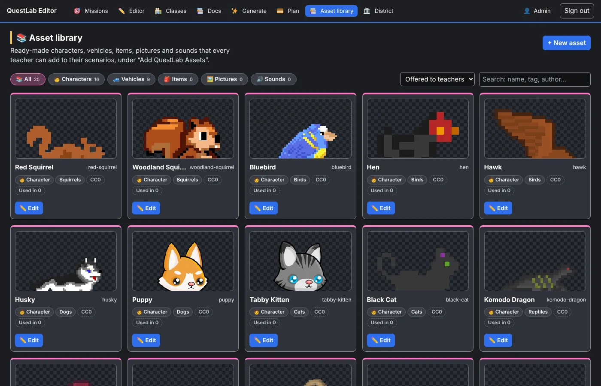
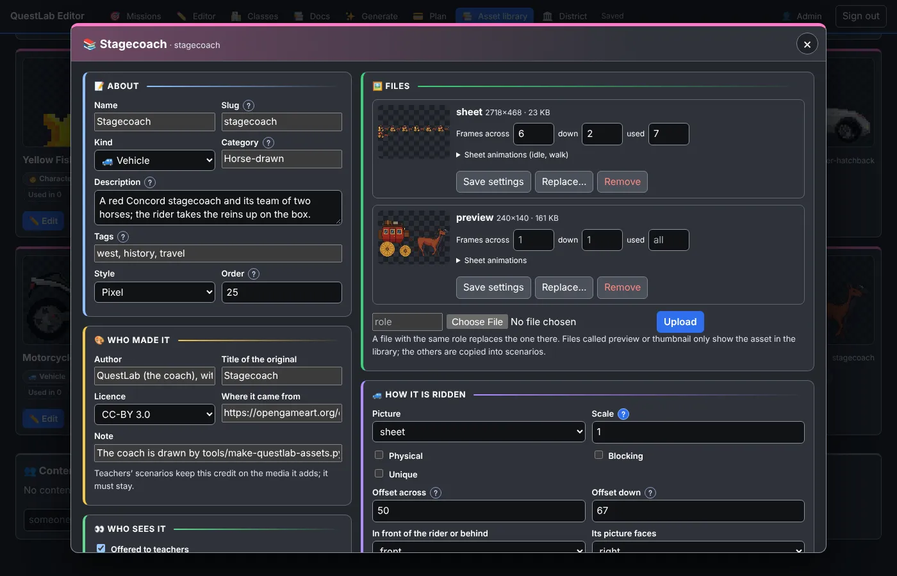

QuestLab has a shared **asset library**: ready-made characters, vehicles, items, pictures and sounds that every teacher can add to a scenario with **🐾 Add QuestLab Assets** on the Characters and Items pages. The library is looked after by **content admins** and administrators, on the editor's **📚 Asset library** page (`/editor/#/library`).



## Who can do what

| | Teacher | Content admin | Administrator |
| --- | --- | --- | --- |
| Add library assets to their own scenarios | ✓ | ✓ | ✓ |
| Edit every scenario, curricular missions and shared samples included | | ✓ | ✓ |
| Make a mission free or curricular | | ✓ | ✓ |
| Play and assign curricular missions without a teacher plan | | ✓ | ✓ |
| Change the asset library, and keep things from a scenario in it | | ✓ | ✓ |
| Choose the content admins | | | ✓ |
| Billing, districts, everyone's classes | | | ✓ |

A content admin is a teacher with more reach over content, not over people or money: they have no billing, district or account powers.

## The page

Every asset is a card, withdrawn ones too. The chips across the top filter by kind (**Characters**, **Vehicles**, **Items**, **Pictures**, **Sounds**); the menu beside them shows those **Offered to teachers**, those **Withdrawn**, or **All**; the search box finds words in the name, slug, category, description, tags and author. Each card shows the asset's picture, its kind and category, its licence (a yellow **No licence** chip when none is given), and in how many scenarios it is used.

Click a card or **✏️ Edit** to open the asset in a panel:



* **📝 About**: name, slug, kind, category, description, tags, style and order. Changing the slug does not affect scenarios that already added the asset.
* **🎨 Who made it**: author, title of the original, licence, where it came from and a note. Teachers' scenarios keep this credit on the media they add, so an attribution licence (CC-BY, OGA-BY) is honoured wherever the asset ends up.
* **👀 Who sees it**: **Offered to teachers** (untick to withdraw it: the editor stops offering it, and scenarios that added it keep their copies), and optionally **Only for organization #**, to offer it only to one school's or district's teachers.
* **🖼️ Files**: each file with its role (`sheet`, `portrait`, `image`, `sound`...). For a picture, set its sprite-sheet grid (**Frames across**, **down**, **used**) and, for items and vehicles, its sheet animations; **Replace…** or **Remove** it, or upload another. Files called `preview` or `thumbnail` only show the asset in the library; the others are copied into scenarios.
* **What adding it makes**, by kind:
  * a character's **animations**: name, file, frames (`0 1 2` or `0-3`), milliseconds and whether it loops. The poses (`stand_right`, `walk_right`, `stand_left`, `walk_left`, `portrait`) are drawn by the game by themselves; other names are moves.
  * a vehicle's or item's **picture**, scale, flags, and for vehicles and wearables where it sits on the rider: offsets, in front or behind, which way its picture faces, how much of the rider it hides, and (vehicles) its speed.
  * a picture's or sound's file.
  * **Advanced: the definition as JSON**, for anything else.
* **🧪 Try it**: add the asset to one of your scenarios, as a teacher would, to see it in a scene. It uses the saved version.

**Save changes** saves the left-hand fields and what adding it makes; file changes are saved by their own buttons. **Delete** removes the asset from the library; scenarios that added it keep their copies.

### New assets

**+ New asset** makes one from a file: choose its kind, name and category and, optionally, its picture or sound. It starts withdrawn, so give it a licence and check it before ticking **Offered to teachers**.

To offer something made in a scenario, such as a character with all its animations or a vehicle with its seat set up, open it on its Characters or Items page and click **📚 Keep in library**. Its pictures, animations and settings are copied as they are saved, into a new withdrawn asset to finish on the Asset library page.

## Choosing content admins

Administrators see **👥 Content admins** at the bottom of the page. Type the email address of an account that has signed in at least once and click **Make content admin**; **Make a teacher again** takes the role away. Administrators' and guests' accounts cannot be made content admins.

From the server, the same is done with:

```sh
php artisan qbl:update-role someone@school.org --role=content_admin
```
