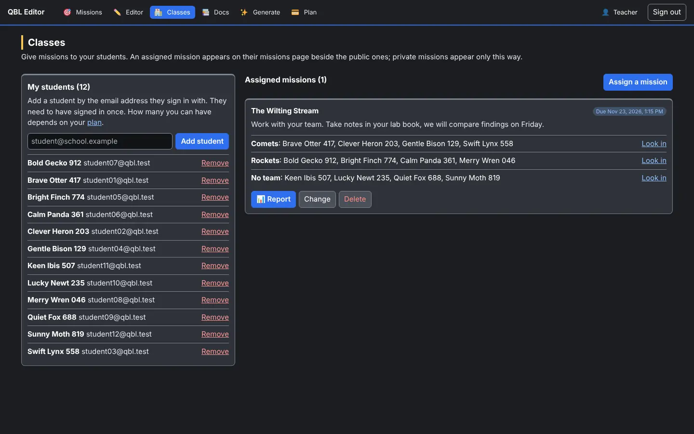
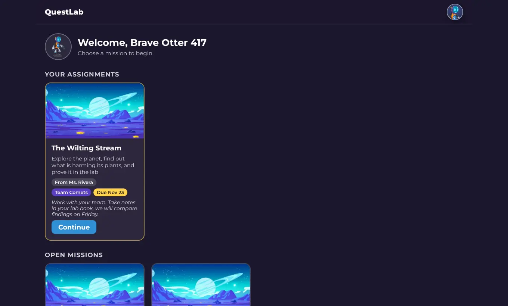
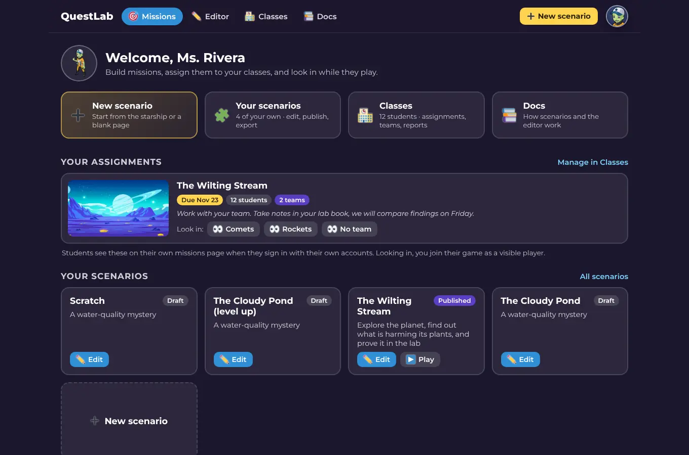

import { Aside, Steps } from '@astrojs/starlight/components';

The **Classes** page is where a mission meets your students. You add them, give them a mission, group them into teams, and, while they play, look in on any team's game.

*Twelve students, one assigned mission with two teams, and a Look in link for each.*

## Missions: public and assigned

A **mission** is a published scenario. Students find their missions on the page they land on after signing in (`/missions`): a grid with one card per mission. Teachers and admins land in the editor instead, which is their dashboard, and reach the missions page from the **Missions** link.

| Kind | Who sees it | Set by |
| ---- | ----------- | ------ |
| **Public** | Everyone, at any time | The scenario's setting **Who can play it** is "Everyone" (the default) |
| **Assigned** | The students a teacher gave it to | A teacher, on the editor's **Classes** page |

A scenario set to "Only students it is assigned to" is **private**: it is on nobody's page until its owner assigns it, and nobody else can open its address. A public scenario can be assigned too, for instance to give it a due date or to play it in teams. The setting applies as soon as it is changed; it does not wait for the scenario to be published again.

*What a student sees. Assigned missions come first, with your name, their team, the due date and your note.*

## Add your students

1. On **Classes**, type a student's email address under **My students** and press **Add student**.
2. The student has to have **signed in once** before they can be added. A student can be in several teachers' lists.

How many students you can have depends on your [plan](/docs/editor/plans-and-generator/). If your school connects QBL to its roster (district sign-in, Clever, Google, a roster file or the [public API](/docs/api-v1/people/)), your classes can arrive already filled in.

## Assign a mission

Press **Assign a mission** and choose:

- a **published scenario**,
- **the students** it is for,
- a **due date** (optional), and
- a short **note** (optional).

The due date and the note are shown on the student's mission card, and a due date that has passed is marked. **Write the note as a task, not a greeting**: it is your voice at the top of every student's screen. [Facilitating](/docs/educators/facilitation/#before-set-it-up-like-a-lesson) has examples.

An assignment can be changed at any time with **Change**.

## Teams

Teams are optional. Add them in the assignment and put students into them, or use **Share students out evenly**.

Each team plays in **its own copy of the world**: the team walks around together and shares what is shared (a boulder one of them knocked down stays down for the whole team, and only for that team). Other teams appear only in the scenes the scenario opens to everyone, such as a meeting room; everywhere else a team is on its own (see [Teams in a scene](/docs/developers/extensions/#teams-in-a-scene)).

Without teams, everyone the mission was assigned to shares one copy. Students left in no team share the assignment's own copy.

You can **change teams at any time.** A team keeps its copy of the world, and its progress, when it is renamed or when students move between them; a student who moves starts in the new team's world with a fresh save there.

<Aside type="tip" title="Team ideas">
Mix strengths and confidence. Rotate roles (navigator, recorder, tester, reporter). Re-form teams between missions so everyone works with everyone. See [Maximizing learning](/docs/educators/maximize-learning/#5-put-students-in-teams-on-purpose).
</Aside>

## Look in on a team's game

**Look in** opens a team's copy of the mission **as yourself**. You are in that team's game as one of them: you see what the team sees (each team's world can differ: what has been picked up, which hotspots and events are active) and the team sees you. What you do there counts in their game.

*You can look in from the Classes page or from your missions page.*

You **follow one team at a time**. To move to another team, open the **Team you are following** tab (🛡️) at the side of the game and choose it: you join that team's game in the scene where most of its players are.

Looking in is for **coaching**: stand next to a team and ask a question. See [Facilitating a mission](/docs/educators/facilitation/#look-in-on-a-team).

<Aside type="note" title="Checking a student's view">
Assigned missions reach the student's own account, and the game and the editor share one sign-in in each browser. To check what a student sees, use another browser or a private window.
</Aside>

## Reports

**Report**, on an assignment's card, shows how the students are doing: progress, objectives, which questions they found hard, and what each student thought before any feedback. See [Reading the reports](/docs/editor/reports/).

## Profiles

Players can look at each other. Clicking another player's avatar, or their name in the Players panel, opens their profile: their avatar as it is dressed, their rank, stars, XP and the badges they have earned (see [Award](/docs/developers/extensions/#award)). A profile shows nothing else: no email address, no class, no activity. Guests have no account and so no profile beyond their name and avatar.

## For developers

How a team's copy of the world is stored, what is kept per player and which tables hold it is described in [Instances, teams and save data](/docs/developers/instances/).
