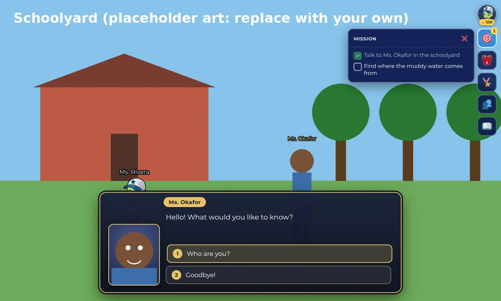
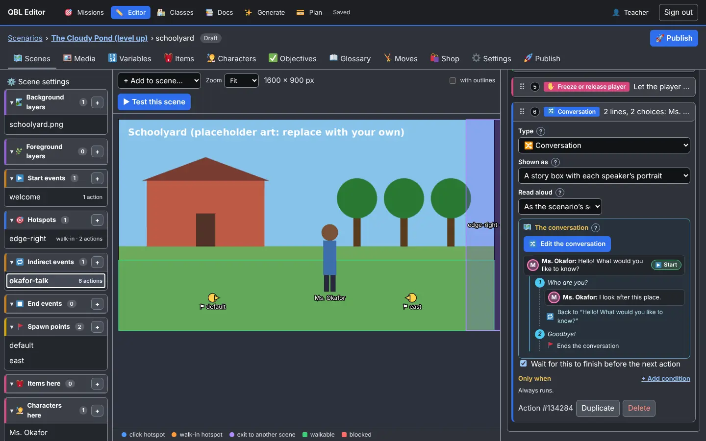
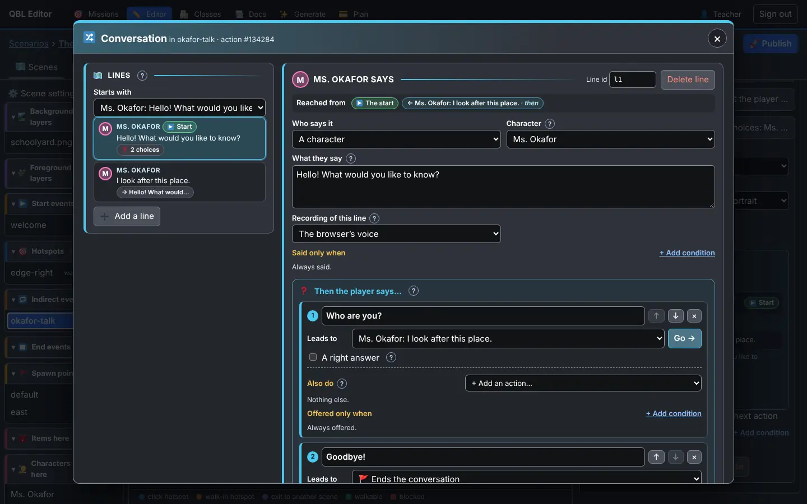
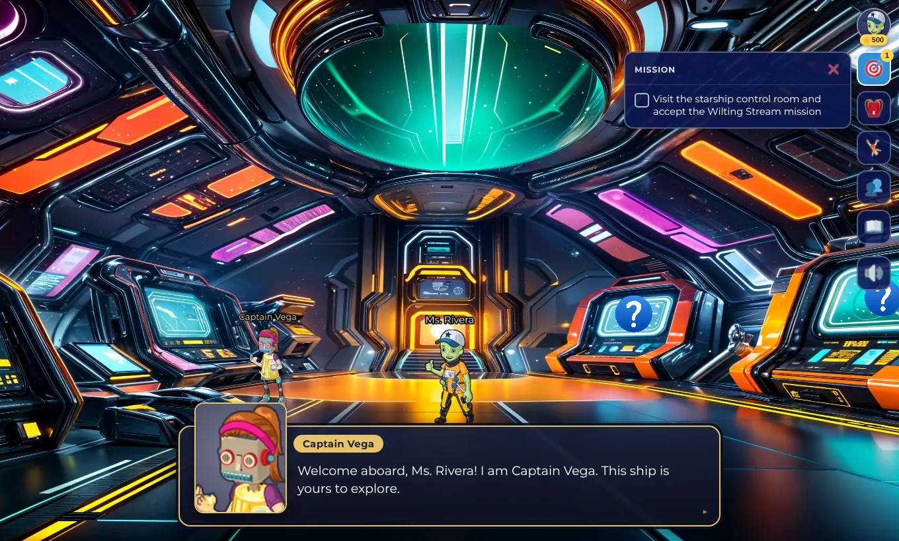

import Host from '../../../components/Host.astro';

import ConversationTree from '../../../components/diagrams/ConversationTree.astro';

import { Aside, Steps } from '@astrojs/starlight/components';

A **Conversation** is a talk the player takes part in. A character says something, the player picks a reply from a few **choices**, and each choice leads to what is said next. It is one action, however many lines it has. (A **Dialogue** action says a single line; use it for remarks and short announcements.)

Conversations are how students *interview* people, *negotiate*, *ask for help* and *practise a language*. They are also one of the best sources of evidence: every line that has choices counts as a question in the [report](/docs/editor/reports/).

*In the game, the line appears in a box with the speaker's portrait. Once the player has read it and clicked on, their choices appear in a box of their own, with their name. Players click a choice or press its number.*

<ConversationTree />

## Make a conversation

<Steps>

1. **Define the character** on the [Characters tab](/docs/editor/library/#characters), and **place it in the scene** with **+ Add to scene… → Character**.

2. Add an **indirect event** (for example `okafor-talk`) and, on the placed character, set **When clicked, run** to that event.

3. In the event, add the actions **✋ Freeze or release player** (freeze), **🔀 Conversation**, then **✋ Freeze or release player** (release). The freeze keeps the student from wandering off while choosing. A freeze always ends when the event finishes, so nobody is left stuck.

4. Open the 🔀 **Conversation** card. A new conversation starts as a small tree you can change: the character greets the player, who can ask *Who are you?* (the answer comes back round to the greeting) or say *Goodbye!*.

5. Press **Edit the conversation** and write your own.

</Steps>

The [walkthrough](/docs/editor/walkthrough/schoolyard/#write-her-conversation) builds a simple talk from Dialogue actions; [Level it up](/docs/editor/walkthrough/level-up/) turns it into a real Conversation with choices.

## The map in the action's card

In the action's card the conversation is drawn as a **map**, followed from the start: each line with who says it, and under a line with choices, each choice and where it leads.

- 🔁 *Back to* marks a choice that returns to a line shown above it.
- 🚩 marks the end.
- Lines that nothing leads to are listed as *Never said*, which usually means a choice is missing.

Click any line, or **Edit the conversation**, to open the panel.

## The conversation panel

The panel lists every line on the left (▶ marks the start; *Starts with* changes it) and edits one line on the right. Put the lines in whatever order helps you: drag a line by its ⠿, or use its ↑ ↓. The order is only for you; the conversation follows its links, and the start stays the start. ↳ marks a line said straight after the one above it.

| Field | What it does |
| --- | --- |
| **Who says it** | The player, or one of your characters |
| **What they say** | The words. You can show a variable with `{{name}}` |
| **Recording of this line** | A recording to play, if you have one |
| **Said only when** | Makes a line conditional. When its conditions do not hold, the conversation skips it and goes on to its *Then go on to* line. That is how to greet a returning player differently |
| **Reached from** | The lines and choices that lead here. Click one to go there. **← Back** returns to the line you were on |
| **Then the player says…** | The choices (below) |
| **Add another box after this one** | Another line said straight after this one, in its own box, before the player answers (below) |
| **Then go on to** | For a line with no choices: the next line, or the end |
| **Line id** | The line's name in the scenario file (`l1`, `l2`…). Renaming it keeps every choice that pointed at it |
| **Delete line** | A box in a row closes up: what led to it goes on to the box after it. Otherwise choices that led to it become endings |

Each **choice** has:

- The **player's words**.
- **Leads to**: another line, **➕ A new line…**, or *Ends the conversation*. **Go →** opens that line.
- **A right answer**: tick it on the choices that are right, and the report says whether each student's first answer was right.
- **Also do**: actions done when the choice is picked, such as setting a variable or running an event.
- **Offered only when**: conditions that decide whether the choice appears at all.
- ↑ ↓ to put the choices in order.

### Several boxes before the player answers

A character often has more to say than fits in one box. Press **➕ Add another box after this one**: a new line, said by the same speaker, comes straight after this one, and the line's choices move on to it, so the player answers after the last box. Do it again for a third box. The boxes of one part are shown together at the top of the line (*Box 2 of 3*); click one to edit it. Each box can have its own speaker, so the player can say something between two of a character's lines.

Picking **➕ A new line…** creates the reply, said by whoever said the line it answers, and opens it, so you can write a branch from top to bottom and use **← Back** to return to the question.

## How it looks in the game

The action's **Shown as** setting picks one of two looks:

- **A story box** with the speaker's portrait (the default). When the player clicks on, their choices appear in a story box of their own, with their portrait and name.
- **A speech bubble** over the speaker. Once it has been read, the choices appear in a box at the bottom of the screen.

Either way the player answers only after the speaker has finished.

Players click a choice or press its number, and cannot walk away while choosing. The action waits until the conversation is over.

## Recipes

<Host who="pinta" side="left">
Interviews, negotiations, a returning visitor, a language lesson: here are the shapes that work.
</Host>

### An interview with a witness

Make one line per piece of information. Give each choice a question the student might ask. Let some questions lead to a new line and some come back to the greeting. After enough questions the witness says more: put **Offered only when** on the later choices, with a condition on a variable that earlier answers set (use **Also do** to set it).

### A hint that leads back to the question

A wrong choice leads to a line where the character gives a hint, whose only choice returns to the original question (🔁). Students see the hint and try again. In the report the question shows the **first answer** and how many tries it took.

### Greeting a returning player

Make two greeting lines. Put **Said only when** on the first (`met_okafor = 0`) and have its choices set `met_okafor` to 1. The second, "Welcome back!", has no condition. The conversation uses the first line that applies.

### Conversation as a gate

Have a choice (**Also do**) set a variable such as `mission_started` to 1, and put a condition on an exit that checks it. The [walkthrough's gate](/docs/editor/walkthrough/schoolyard/#a-gate-that-needs-a-conversation) works this way, with a dialogue in place of the conversation.

<Aside type="tip">
Every line with choices counts as a **question** in the report: it shows each student's first answer and how many tries they took. Tick **A right answer** on the right choices and the report also says whether the first answer was right. A wrong answer that leads to a hint and back to the question is the pattern for "try again".
</Aside>

<Aside type="note">
To give stars or XP for a choice, put the award in an indirect event and have the choice **Run event** it: awards are only given for an event's own actions. A **Jump** in a choice ends the conversation.
</Aside>
