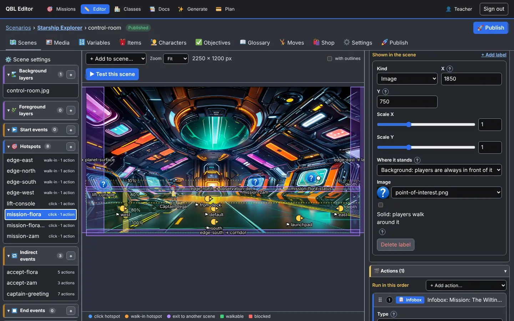

import Host from '../../../components/Host.astro';

import EventFlow from '../../../components/diagrams/EventFlow.astro';

Everything that *happens* in a mission is an **event**, and every event is an ordered list of **actions**. A hotspot the student clicks is an event; so is the welcome message when they arrive, and so is a conversation.

*A hotspot that opens an infobox. The inspector on the right is the event: its settings, its conditions and its list of actions.*

## An example in one minute

A rock blocks the path. Students must pick up the key to unlock the gate.

| Event | Kind | Conditions | Actions |
| ----- | ---- | ---------- | ------- |
| `take-key` | Hotspot (click) | `has_key = 0` | 📋 **Infobox** "You found a key!" then 🔢 **Variable** `has_key` set to 1 |
| `gate` | Hotspot (walk into) | `has_key = 1` | 🚪 **Jump** to the next scene |
| `gate-locked` | Hotspot (walk into) | `has_key = 0` | 🔤 **Text overlay** "The gate is locked." |

Three events, two conditions, one variable. Every mission, however big, is made of this.

The same rules at work in a different mission, The Cloudy Pond from the [walkthrough](/docs/editor/walkthrough/schoolyard/#a-gate-that-needs-a-conversation): an exit that only lets students through once they have talked to Ms. Okafor.

<EventFlow />

## The four kinds of event

| Kind | Runs when | Typical use |
| ---- | --------- | ----------- |
| **Start event** | A player arrives in the scene | A welcome message, music, placing a picture |
| **End event** | A player leaves the scene | A farewell, saving a flag |
| **Hotspot** | A player clicks it, or walks into it | Doors, things to read, things to collect, edge exits |
| **Indirect event** | Another event's **Run event** action starts it, or a click on a placed character | Conversations, answers to a question, anything used from more than one place |

You can change an event's **Kind** at any time under ⚙️ Settings.

## An event's settings

| Setting | What it does |
| ------- | ------------ |
| **Name** | A label for you. It is what the outline shows |
| **Another event may interrupt this one** | When any event starts, running events marked this way stop where they are |
| **Hotspots do nothing while this runs** | Stops players triggering other hotspots mid-conversation |
| **Who sees it** | *Only the player who sets it off* (the default) or *Everyone in the scene* |

**Who sees it** is for moments that belong to the room, such as a rockfall: the other players in the scene see and hear its pictures, text, sounds, video and dialogue as they happen. What the event *does* stays with the player who set it off: variables, awards, jumps, freezing and questions. See [Who sees an event](/docs/developers/extensions/events/#who-sees-an-event).

## Conditions

<Host who="sam" side="right">
Conditions are yes-or-no questions about variables. All must be yes, or the event (or action) sits this one out.
</Host>

An event, an action, an objective and an infobox button can each have **conditions**. A condition compares a **variable** with a **value** using `=`, `!=`, `>`, `<`, `>=` or `<=`, or **`%` (is a multiple of)** and **`!%` (is not a multiple of)**: `turns` `%` `2` holds on even turns and `turns` `!%` `2` on odd ones; `visits` `%` `3` holds on every third visit. Press **+ Add condition** and choose from the variables you have defined. **All** the conditions in a list must hold.

* On an **event**, conditions decide whether it runs. A hotspot whose conditions fail is not there at all: its labels disappear and it cannot be clicked. That is how a collected object vanishes (the hotspot is conditioned on `collected = 0`).
* On an **action**, the box is headed **Only when**, and a failing action is skipped while the rest run.
* On an **infobox button**, **Offered only when** hides the button.

Variables are defined on the [Variables](/docs/editor/library/#variables) tab. If a condition names a variable that is not defined, the list shows it marked *(not defined)*.

## Labels

A hotspot can have **labels** that mark it in the scene: a **Text**, an **Image** or a **Spritemap**. Press **+ Add label** under 🏷️ Labels, then set its position and scale (or drag it on the canvas). **Where it stands** says how it is layered:

* **Background**: players are always in front of it.
* **Object**: players walk behind it and in front of it, depending on how high up they are. It stands on its bottom edge.
* **In front of everything**, players included.

Picture labels can be made **Solid**, so players walk around them. A solid label stops being in the way when its hotspot's conditions no longer hold, such as a rock that has been cleared.

**Only show it near** makes a label a hint: it appears only while the player is within that many pixels of the hotspot, or points at it, which keeps a scene from being covered in words (a small question mark that is always there, with the thing's name as a hint above it, is how generated missions mark what can be clicked). A picture can **Pulse to draw the eye**; pictures hold still unless you ask, since the pointer already shows what can be clicked.

## Actions

Under 🎬 Actions, **+ Add action…** lists every type with a one-line description, in groups:

| Group | Actions |
|---|---|
| 🗣️ Talking and storytelling | Dialogue, Narration, Conversation |
| 📝 Boxes and words on screen | Infobox, Text overlay |
| 🧑 Characters and the player | Walk, Play an animation, Freeze or release player, Show or hide avatar |
| 🎞️ Pictures, video and sound | Image in scene, Image overlay, Spritemap, Video, Audio, Translate |
| 🎥 Scenes, camera, weather and bench | Jump, Camera, Weather, Bench |
| ⏱️ Timing and flow | Wait, Run event, Repeat, Cancel action, Cancel event |
| 🏆 Rewards and progress | Award stars or XP, Add a glossary word, Variable, Open the marketplace |

An action's card takes its group's colour. The Type picker on each card, a button's action and a choice's actions use the same groups. A new action arrives with sensible starting values so it is valid straight away.

* Anything with an **X** and **Y** in the scene (**Walk** to a spot, **Translate**, **Image in scene**, **Spritemap**) has **📍 Pick on the scene** under them: press it, then click the scene to set both. While choosing, a click on a character or hotspot picks the spot under it instead of selecting it. These spots are drawn on the canvas while the event is selected, and can be dragged there.
* Actions run **in the order listed**. **Drag the ⠿ grip** at the left of a card to move it; drop it on the upper or lower half of another card to put it before or after.
* Click a card to open it. Its one-line summary tells you what it does when it is closed.
* **Wait for this to finish before the next action** (on by default) makes the event pause until this action is done. Turn it off to let the next action start at once, for a sound that plays under a conversation.
* **Duplicate** copies an action; **Delete** removes it.
* Text in any action can show variables with `{{variable_name}}` and pictures with `{{media:ID}}`.

### The action types

**Say something**

| Action | What it does |
| ------ | ------------ |
| 📋 **Infobox** | A box of text, pictures, video, sounds and cards, with optional buttons. It can have several pages. [More](/docs/editor/infoboxes/) |
| 💬 **Dialogue** | A speech bubble over the speaker, or a *story box* with a portrait. The speaker is the player or a **Character** |
| 📜 **Narration** | The narrator speaks: the same story box, with no portrait or name, read aloud in the narrator's voice. For setting the scene and saying what happens next |
| 🔀 **Conversation** | A dialogue tree: lines said by the player and characters, where the player picks what to say next. [More](/docs/editor/conversations/) |
| 🔤 **Text overlay** | Text over the screen: where, how long, size, colour and style |

**Show something**

| Action | What it does |
| ------ | ------------ |
| 🖼️ **Image overlay** | A picture over the screen |
| 📌 **Image in scene** | A picture placed in the scene, and whether it is drawn above, among or behind avatars |
| 🎞️ **Spritemap** | An animated sprite sheet placed in the scene |
| 🎬 **Video** | A video over the screen |
| ↔️ **Translate** | Move, resize or fade something another action is showing |

**Sound**

| Action | What it does |
| ------ | ------------ |
| 🔊 **Audio** | A sound or music: volume, loop, and **Background music: keep playing across scenes** |

**Flow**

| Action | What it does |
| ------ | ------------ |
| 🚪 **Jump** | Go to another **Scene**, and **Arrive at** one of its spawn points |
| 🔗 **Open URL** | Open a web address, **in a new tab** (ticked to start with: the game and the event go on) or in this one (the player leaves, after this scene's end events, and their progress is saved). Variables fill in: **`{{QL_SCENARIO_LAUNCH_URL}}`** is the scenario the teacher just launched, the last action of a *scenario launcher scene*. With nothing launched it is empty: nothing opens and the event goes on. See [Open URL](/docs/developers/actions/open-url/) |
| 🚀 **Go to the launched mission** | Leave this mission for the one the teacher has just launched: the last action of a *scenario launcher scene*, like Open URL to `{{QL_SCENARIO_LAUNCH_URL}}` in the same tab. Like a jump it ends the event, after this scene's end events. With nothing launched (a player wandering in another day) nothing happens and the event goes on, so put what to say then after it. See [Launch a mission](/docs/editor/classes/#launch-a-mission-when-the-class-is-ready) |
| ⏳ **Wait** | Pause for a **Duration** in milliseconds |
| ▶️ **Run event** | Run another event, usually an indirect one. An event that is already running is not started again |
| 🔁 **Repeat** | Start this event again from its first action, usually with a condition so it can end |
| ✖️ **Cancel action** | Stop another action: remove a picture, stop a sound |
| ⏹️ **Cancel event** | Stop an event of this scene that is running: it goes no further, and what it is showing or playing stops. An event that is not running is left alone, and can still start later. **Cancel event** then **Run event** restarts it; pick the event itself to end it there. Background music it started keeps playing (stop that with **Cancel action**) |

**The player**

| Action | What it does |
| ------ | ------------ |
| ✋ **Freeze or release player** | Stop the player walking while a character talks, or let them walk again. A freeze always ends when the event finishes or the scene changes, so nobody is left stuck |
| 👤 **Show or hide avatar** | Hide the player's avatar (stepping into a rocket) or show it again |
| 🤸 **Play an animation** | Make the avatar, an item, a vehicle or a character jump, dance or do anything its sprite sheet has |
| 🚶 **Walk** | Walk a **Character** or **The player** to a spot, a spawn point, or **Another scene, through its doors**. [Details below](#walking) |

**What the mission remembers and gives**

| Action | What it does |
| ------ | ------------ |
| 🔢 **Variable** | Set a variable, or add, subtract, multiply, divide, take the remainder, or pick a random whole number up to a value |
| ⭐ **Award stars or XP** | Give stars (spent in the marketplace) and XP (adds up to ranks), with a note, and optionally a **badge** shown on the player's profile |
| 📖 **Add a glossary word** | Give the player a word from the [glossary](/docs/editor/library/#glossary) |
| 🛍️ **Open the marketplace** | Open the shop where players spend stars |

:::note
An **award** is given **once per student** by default, however often the event runs; tick **Give it every time this runs** to change that. Stars and XP belong to the player's account and carry across missions; guests earn none. Put awards in an event, not on an infobox button.
:::

### Walking

**Walk** moves someone on foot: around whatever is in the way, with their walking pictures, turning the way they go. Choose **Who walks** and **Walk to**; only the fields for that destination are shown.

* **A spot in the scene**: its **X** and **Y**. Press **📍 Pick on the scene** and click the scene where the walker should go, rather than typing the numbers; **Esc** or **Cancel** stops without changing them. While the event is selected, the spot is drawn on the canvas as a marker, with a dashed line from where the character stands, and the marker can be dragged.
* **A spawn point in the scene**: one of the scene's spawn points.
* **Another scene, through its doors**: the walker heads for a hotspot of this scene whose jump goes to that scene (an exit made on the scene map is one), goes through it and arrives at the spawn point the jump names. **Then walk on to** sends a character that walks around on its own on to a spawn point there.

**Speed** is in pixels per second (players walk at 420 unless the scenario says otherwise), and **Face on arriving** turns the walker at the end. With **Wait for this to finish** ticked, the next action waits until they get there.

What happens depends on the character. One set to **walk around on its own** (Characters page, *Getting around*) walks for everyone, can cross several rooms, and stays where it went. Any other character walks on this player's screen in this scene, and is back in its place next time; one that walks out through a door is gone until the scene is entered again. The player walks even while frozen, so **Freeze**, then **Walk** the player, makes a short cutscene; walked to another scene, they go through the door as if they had walked into it.

### Infoboxes, questions and conversations

These have their own pages, because they are where most of a mission's teaching happens:

* **[Infoboxes and questions](/docs/editor/infoboxes/)**: writing the content, pictures, slideshows, flip cards, answer boxes, and marking answers **right**, **wrong** or **try again**.
* **[Conversations](/docs/editor/conversations/)**: a talk where the player chooses what to say, drawn as a map and edited line by line.

### Reading aloud

Text-showing actions have **Read aloud** and **Recording to play instead**. The browser's own voice reads the text and lights each word as it is spoken. Lines of characters who have a recorded voice (Characters, **🎙️ Record voices**) play their recording, lit word by word as it is said; a recording you attach yourself is lit at an even pace over its length. Set it for the whole mission in Settings, and override it per action. Players can switch it off for themselves. What no character says (narrations, and text overlays and infoboxes read aloud) is the **narrator's**: by default a dramatic, charismatic storyteller, or another voice (or none) chosen in Settings, under **💬 Talking and reading**. **🎙️ Record voices** records the narrator's lines along with the characters'.
