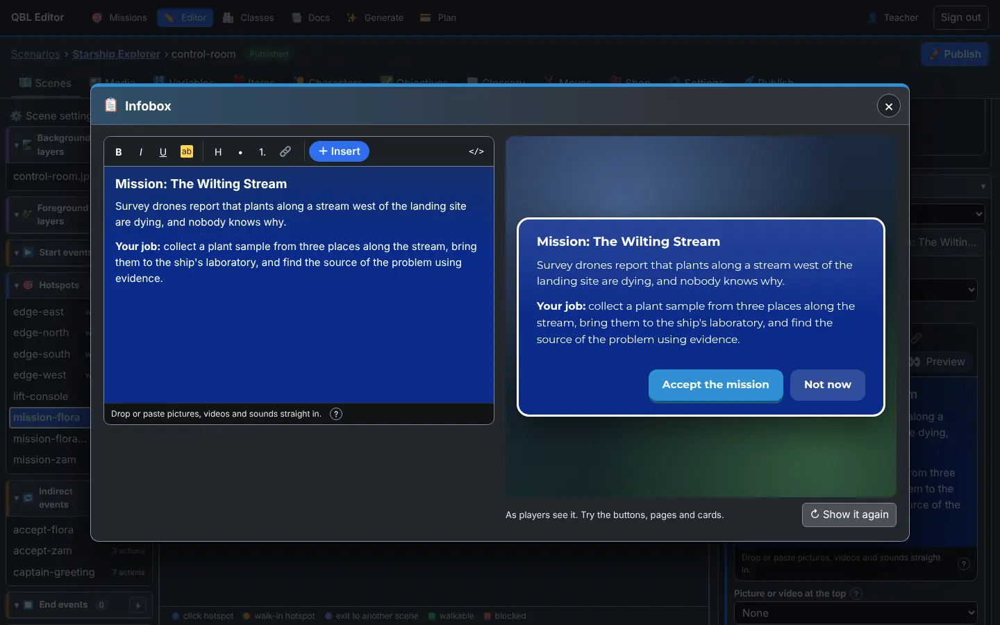
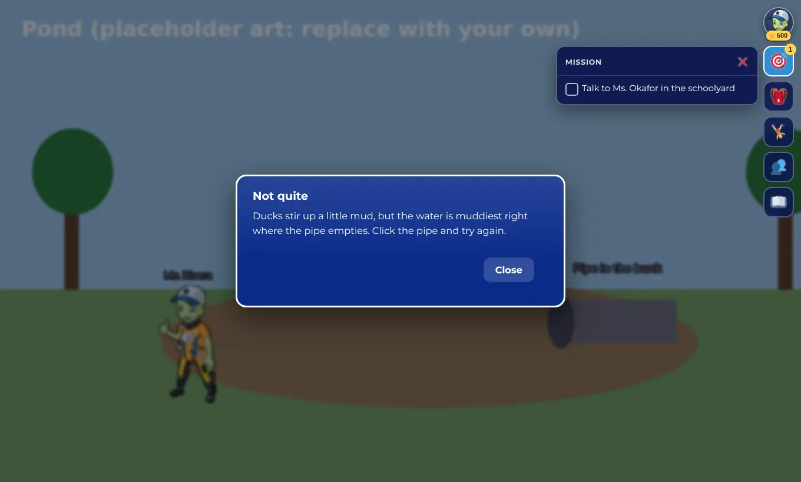
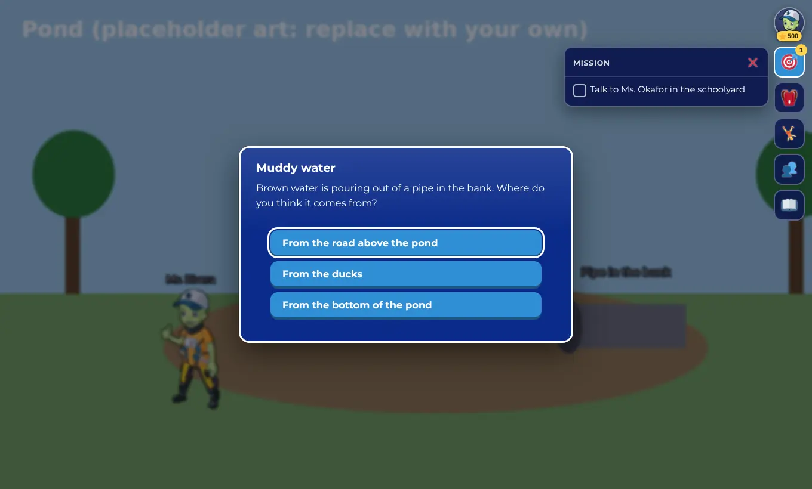

import { Aside, Steps } from '@astrojs/starlight/components';

An **infobox** is the box of text, pictures and buttons that opens over the game. It is the main way a mission *tells* students something, and, with buttons marked right and wrong, the main way it *asks* them something. It is one of the [actions](/docs/editor/events-and-actions/#the-action-types) you add to an event.

*The infobox designer. You write on the left; the right shows the box exactly as the game draws it.*

## Add one

<Steps>

1. Select a hotspot or event in the [scene editor](/docs/editor/scene-editor/), open 🎬 **Actions** and press **+ Add action… → 📋 Infobox**.

2. Open the card and write in the **Content** box. You see the text as it will look, not as HTML.

3. Under **Buttons**, add one for each choice. Leave a button's action as *Just close the box* for a plain "OK", or give it an action: a jump, a variable change, another infobox, or **Run event**.

4. Press **👀 Preview** to see the box large, with its pages, slideshows and buttons working.

</Steps>

An infobox also has a **Picture or video at the top**, a **Size** (small, medium or large), a **Colour** for its edge and main buttons, and a tick for **Can be closed without choosing a button**. A button's action can be any type, including another infobox with buttons of its own: the next box takes over without the screen flashing between them.

## Writing the content

Type, and use the toolbar for **bold**, *italic*, underline, a highlight, a heading, lists and links. **＋ Insert** puts in:

| Insert | What players get |
| ------ | ---------------- |
| 🖼️ **Picture** | A picture from the media library, small, medium or full width, with a caption. Tapped, it opens large. |
| 🎞️ **Slideshow** | Several pictures to swipe through, with arrows and dots. |
| 🎬 **Video** | A video with its controls. It can start by itself (without sound) and repeat. |
| 🔊 **Sound** | A sound or a recording with play controls. |
| 💡 **Callout** | A coloured note: a tip, a fact, a warning, or something to think about. |
| 👆 **Reveal card** | A question or prompt that opens to show what it hides. What it hides is not read aloud until it is opened. |
| 🃏 **Flip card** | A card with a front and a back that turns over when tapped. |
| ✏️ **Answer box** | A box to type an answer in. See [Answer boxes](#answer-boxes). |
| 🎛️ **Controls** | A bench of sliders, switches, a wheel of chance and meters side by side, with lines that show only while the controls are set a certain way. See [Hands-on instruments](#hands-on-instruments). |
| 📖 **Glossary word** | Select a word in the text first. Players tap it to see what it means, and it goes into their glossary. |
| 🔢 **Variable** | A variable's value, such as a score, shown as a blue chip in the editor. |
| 📄 **New page** | What comes after is on the next page. Players step through with **Next** and **Back** (or ← and →), the dots showing where they are. The box's buttons are on the last page. |

Pictures, videos and sounds can also be **dropped or pasted** straight into the text: they are uploaded to the media library and put where you dropped them. Several pictures dropped at once become a slideshow. Click a block to change it in a pop-up; select it and press <kbd>Delete</kbd> to take it out, or <kbd>Alt</kbd>+<kbd>↑</kbd> and <kbd>Alt</kbd>+<kbd>↓</kbd> to move it.

**&lt;/&gt;** shows the HTML, for anyone who wants to write it by hand. It is cleaned exactly as the game cleans it.

### Show the player's own words and scores

Text in an infobox can show variables with `{{variable_name}}`. Insert a 🔢 **Variable** chip, or type it, to show a score, a count (*"You have collected 2 of 3 samples"*) or whatever an answer box saved.

## Answer boxes

An **answer box** saves what the player types in a variable when they press one of the box's buttons, *before* that button's action runs. A number is saved as a number.

- The first button (the one <kbd>Enter</kbd> presses, such as *Check*) waits until something has been typed.
- The other buttons (*I don't know*, *Hint*) take whatever is there.
- The answer can then be shown with `{{name}}`, tested in a condition, and read in the class report, which lists what was typed beside the button pressed.

**Example: a prediction.** Before a test, ask for a guess and keep it:

1. Add a variable `prediction` (a player's own variable) on the [Variables tab](/docs/editor/library/#variables).
2. In an infobox, write *"The test strip is about to go in the water. What do you think it will read, and why?"* and insert an **Answer box** that saves to `prediction`.
3. Give it two buttons: **Test it** and **I'm not sure**.
4. After the test, a second infobox can say: `You predicted {{prediction}}. The strip reads 3.`

The student has committed to a guess before seeing the result, and you can read what it was.

## Hands-on instruments

A 🎛️ **Controls** block puts several controls side by side, for students to experiment with: set the rope length and the number of pulley wheels, switch a battery on, spin a wheel to see which way the wind blows. Each control saves its value in a variable when a button of the box is pressed, as an answer box does, so the button's action and later conditions can test it.

| Control | Written as | Saves |
| ------- | ---------- | ----- |
| Slider | `<input data-qbl="slider" data-var="rope" data-min="0" data-max="20" data-step="1" data-value="8" data-unit=" m" data-label="Rope">` | a number from `min` to `max` |
| Switch | `<input data-qbl="switch" data-var="brake" data-label="Brake">` | 1 (on) or 0 (off) |
| Wheel of chance | `

` | the option it lands on (repeat an option to make it likelier) |
| Meter | `

` | nothing: it shows a value as a bar |
| Shown when | `
= 12; brake = 1">Enough rope!
` | nothing: what is inside shows only while every condition holds, as students move the controls |

Clicking the block opens its HTML with a reminder of how each is written; its card in the editor lists what it holds. Add each control's variable on the [Variables tab](/docs/editor/library/#variables) first. Put `{{rope}}` in `data-value` to open the box as the student left it.

**Example: a pulley rescue.** A box with a *Rope length* slider, a *Pulley wheels* slider and a *Brake* switch, a line that shows *"The rope is too short to reach Mo"* while the rope is under 12 m, and two buttons, **Lift!** and **Step away**. **Lift!** sets `tested` to 1; the actions after the box test the variables: with the rope long enough, two wheels or more and the brake on, Mo comes up; otherwise a box says what went wrong, and the instrument opens again. The AI generator builds its experiments this way.

## Maths, science and graphs

Three blocks in **＋ Insert** are for science and maths. Each loads its library only in a box that uses it, so they cost nothing elsewhere.

| Block | What it does |
| ----- | ------------ |
| **🧮 Maths or chemistry** | A formula typeset properly on a line of its own. You write it in TeX and see it as you type: `\frac{mass}{volume}`, `x^2`, `\sqrt{x}`. Wrap chemistry in `\ce{…}` and formulas, arrows and charges set themselves: `\ce{2H2 + O2 -> 2H2O}` |
| **🧪 Worked-out value** | The value of a formula, worked out from the box's sliders and switches as they are now, and from variables. Write it as on a calculator: `mass / volume`, `round(sqrt(x), 1)`. It changes as the player moves a slider, and can be saved in a variable when a button is pressed |
| **📈 Graph** | Axes with **curves** (formulas of `x`; other names are sliders and variables, so a curve moves with its slider), **points players drag** (each saved in two variables), and **recorded data** from a [bench](/docs/editor/bench/#graph) |

A graph's points and a worked-out value work together: put two draggable points on a graph, and a worked-out value of `(by - ay) / (bx - ax)` shows the slope of the line through them as they are dragged.

### Checking an answer

An **Answer box** can check what was typed. Fill in **The right answer** and choose the variable that is told whether it was: 1 for right, 0 for wrong, as a button is pressed. Test that variable in a condition of what the button does next.

The right answer can be:

- a number: `12.5`
- a quantity with its unit: `9.8 m/s^2`. Any unit of the same kind is then right (`980 cm/s^2`), and a bare `9.8` is not
- a formula of variables: `mass / volume`
- words, with several right answers separated by `|`: `carbon dioxide | CO2`

**How close a number has to be** takes a share (`5%`) or an amount (`0.5`).

<Aside type="tip">
Do not name a variable after a unit (`m`, `g`, `s`, `h`, `L`). In a formula, a name with nothing in it yet is read as the unit.
</Aside>

## Marking right and wrong answers

A button's **Shows as** says what kind of answer it is:

| Shows as | What the student sees | What happens next |
| -------- | --------------------- | ----------------- |
| **✓ Right answer** | The button turns green with a tick and a burst of stars | The box closes and its action runs |
| **✗ Wrong answer** | It turns red and shakes | The box closes and its action runs |
| **↻ Wrong: try again** | It shakes and is crossed out | The box **stays open** for another try. Its action, if it has one (a sound, adding one to a "tries" variable), runs while the box stays open |

A box that cannot be closed must have at least one button that is always offered and is not *Try again*, so nobody gets stuck.

Because the report records the **first answer** a student chose and how many tries it took, a marked question is also a check on what students thought *before* any feedback. See [Reading the reports](/docs/editor/reports/).

*A "Wrong" button shows its own box. This one explains and sends the student back to look.*

### A quick question

One box is enough:

1. Untick **Can be closed without choosing a button**.
2. Write the question and add one button per answer.
3. Mark the right answer **✓ Right answer** and the others **↻ Wrong: try again**.
4. Put the explanation on the right answer's button, as another infobox.

### A question with feedback for each answer

This is the standard pattern for a question that teaches. It lets *each wrong answer* explain itself.

1. A hotspot or indirect event holds an infobox with **Can be closed without choosing a button** *unticked*, and one button per answer.
2. Each button's action is **Run event**, pointing at its own **indirect event**.
3. The right-answer event sets a variable, gives the award and shows an explanation. Each wrong-answer event just explains and lets the player try again.

The [walkthrough](/docs/editor/walkthrough/pond/#the-question) builds exactly this, and [Patterns](/docs/editor/patterns/) lists more. For advice on what to write in the wrong-answer boxes, see [Write wrong answers that teach](/docs/educators/design-for-learning/#write-wrong-answers-that-teach).

<Aside type="note">
Give stars or XP in an **event**, not on an infobox button: awards are only given for an event's own actions. If a choice should give an award, have it **Run event** to one that does.
</Aside>

## Read aloud

An infobox has **Read aloud** and **Recording to play instead**. The browser's own voice reads the text and lights each word as it is spoken, and you can set it for the whole mission in [Settings](/docs/editor/settings-and-publishing/#settings) and override it per action. Players can switch it off for themselves.
