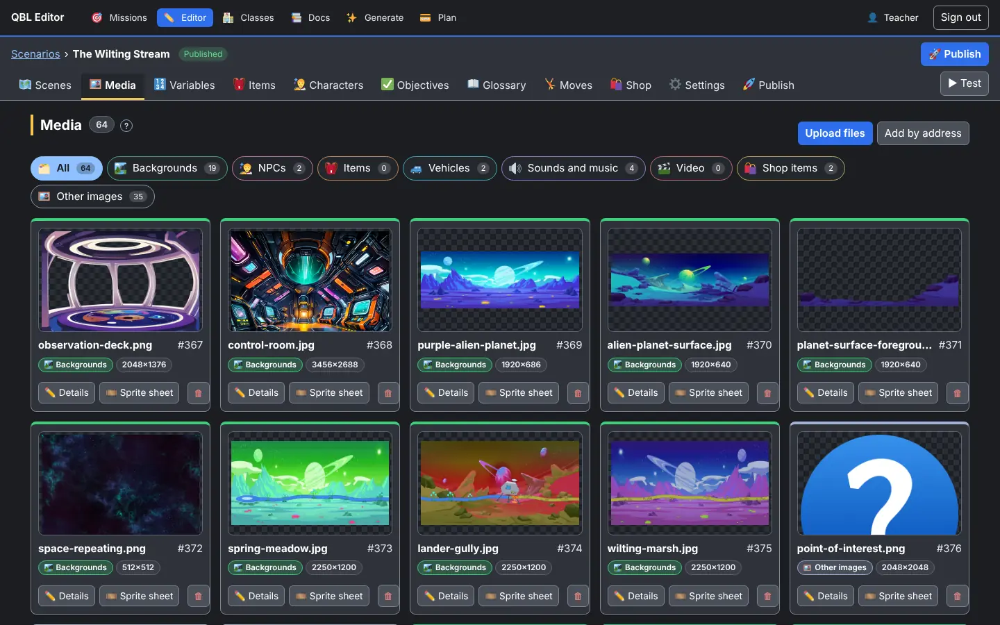
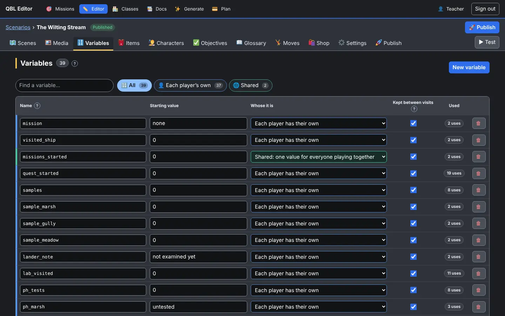
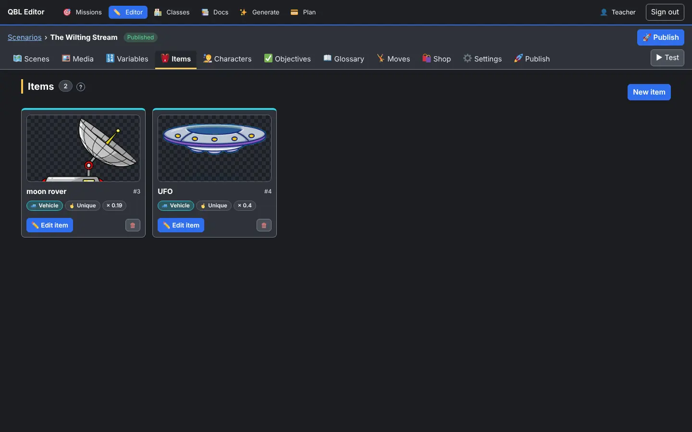
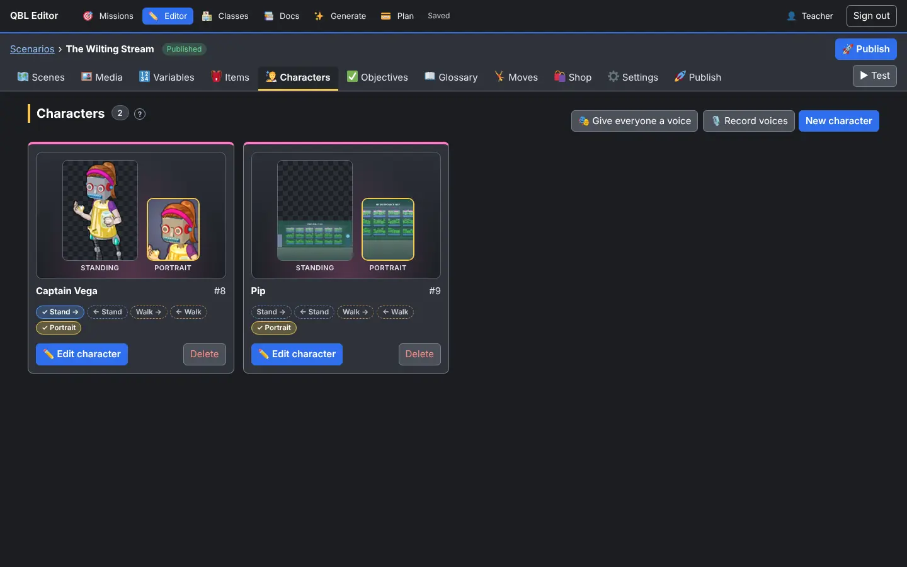
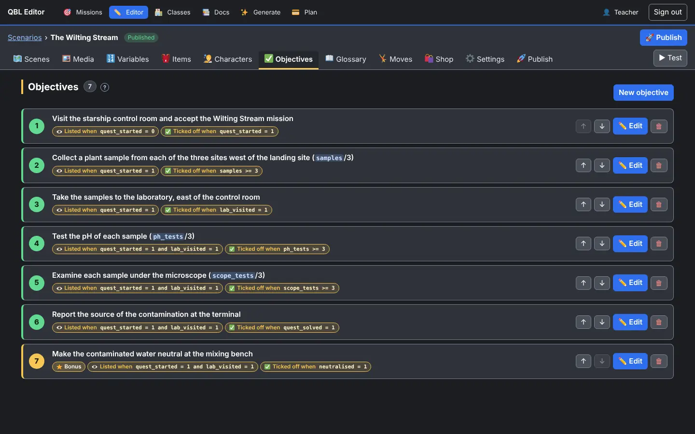
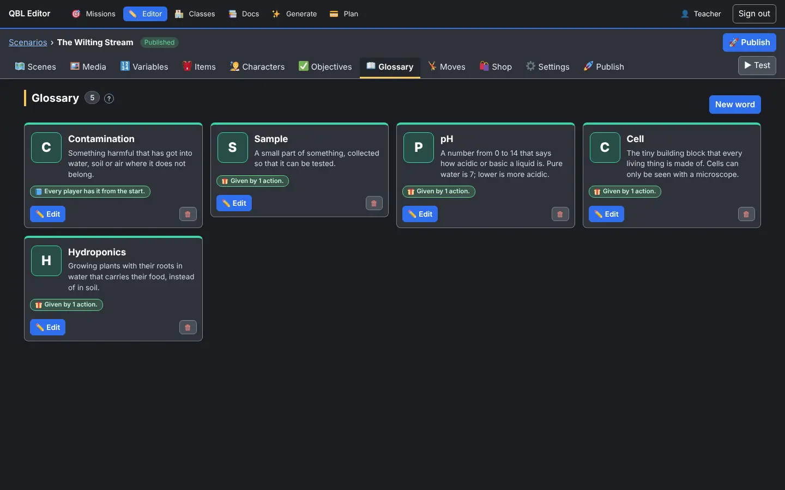
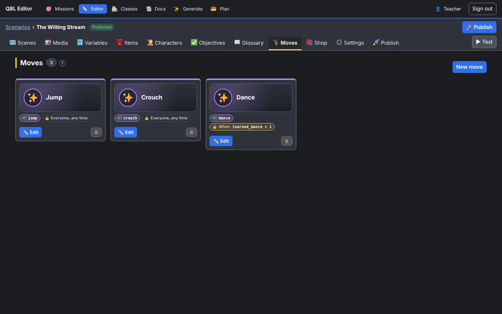

The tabs after **Scenes** hold the things a scenario defines once and uses in many places. Define them here, then pick them from lists in the scene editor and in actions.

## Media

The images, sounds and videos the scenario uses. **Upload files** (pictures: PNG, JPEG, WebP, GIF; sound: MP3, WAV, OGG; video: MP4, WebM) or **Add by address** to point at a file already on the web.

Media is filed under sub-tabs by what it is used for: **Backgrounds**, **NPCs**, **Items**, **Vehicles**, **Sounds and music**, **Video**, **Shop items** and **Other images**. A file follows how you use it; one uploaded while a sub-tab is open is filed there until its use says otherwise, and **Details → Filed under** overrides it.

Each card previews the file, says what it is filed under and its size, and marks a sprite sheet or an animated PNG. Each kind has a colour, on its card and on its sub-tab. Click a picture or **✏️ Details** to open the file in a panel over the page; **🎞️ Sprite sheet** opens the same panel at its sprite sheet. Press Escape, the ×, or click outside the panel to close it. The panel has two parts:

* **📝 Details**: a large preview, then name, address, type, load order, scale, size and **Filed under**.
* **🎞️ Sprite sheet and animations** (images). A sprite sheet is one picture holding frames in a grid. Say how many **Frames across** and **Frames down**: characters can then take frames from it on the Characters page, and several characters can share one sheet. Animations named here are for items, vehicles and pictures: add one and click frames on the sheet to put them in order (shift-click adds every frame up to the one you click); a small preview plays it. `idle` and `walk` play by themselves, and `jump`, `spin`, `crouch`, `wave` and `dance` are built-in moves.

An **animated PNG** is kept as it is: its card says how many frames it has and how long it plays. It plays by itself wherever it is used, and on the Characters page an animation can take all of its frames or some of them.

The 🗑 on a card deletes the file, as does **Delete** in its panel.

:::caution
Deleting media leaves anything that used it without a picture.
:::

## Variables

What the scenario remembers. The page is a table with one line per variable, edited where it stands. Each has a **Name**, a **Starting value** and:

* **Whose it is**: *Each player has their own*, or *Shared: one value for everyone playing together*. The line's left edge is blue for a player's own variable and green for a shared one.
* **Kept between visits**: a player's own variable is kept with their save; a shared one is kept with the group's game.

**Used** counts the places that use the variable: conditions, Variable actions, and text that shows it. *Not used* means nothing tests it, changes it or shows it, which is often a leftover or a misspelling somewhere. Above the table, **Find a variable…** narrows the list by name, and **All**, **Each player's own** and **Shared** show one kind.

Conditions and actions refer to variables by name, so renaming one does **not** update the conditions and actions that already use it. Text can show a variable's value with `{{variable_name}}`.

A few reserved names are always there, such as `{{QuestLabPlayerName}}`. See [Variables](/docs/developers/extensions/#variables).

## Items

Things players can pick up, wear or ride. Each card shows the item's picture and labels for what it is: **Item**, **Wearable** or **Vehicle** (each in its own colour), **Unique**, **In the scene**, **Blocking**, its scale, and how many conditions it has. Click the picture or **✏️ Edit item** to open it in a panel; **New item** opens the new one straight away.

The panel has the item itself on the left: its name and picture, **Unique** (only one player can hold it), **Physical**, **Blocking** (avatars walk around it), **Wearable** and **Vehicle**. A vehicle is always a single object: it goes where it is driven and stays where it is left. On the right are its settings, in groups that appear only when they apply: **In the scene** (scale, where it stands, and the blocking radius for a blocking item), **Worn** or **Ridden** (offsets, in front of or behind the avatar, which way the artwork faces, and **Hide the avatar below**: how far down the item's picture the avatar stops being drawn, 0 at the top and 1 at the bottom, so a rider sits in a UFO or a car instead of their legs showing beneath it), **Vehicle** (speed multiplier), **In the bag** for something players carry (when they have it, and the description they read in their bag), and **When it is there** (conditions). Place items in scenes from the scene editor.

### QuestLab Assets: ready-made vehicles

**🐾 Add QuestLab Assets** on the Items page opens the asset library's vehicles: four cars (a red convertible, a yellow roadster, a farm truck and a silver hatchback), a motorcycle, a bicycle, two saddled horses (bay and palomino) and a stagecoach with its team of horses. Each card shows it moving (wheels turning, legs walking), its speed and who drew it.

**+ Add to scenario** copies its sprite sheet into the scenario's media and makes a vehicle that is ready to ride: its `idle` and `walk` animations play by themselves, it is moved so the rider sits in the seat (on the driver's box, in the saddle, behind the wheel), the rider is cut off below the seat, and it goes faster than walking. In the cars with a roof the rider is seen through the windows. Horses can also `gallop` with a *Play an animation* action. Change any of it afterwards in the item's panel, and place it in a scene.

## Characters

People and creatures players meet. Each card shows the character **Standing** and its **Portrait**, its name, and a label for each pose: a solid one for a pose that is drawn (✓), a dashed one for a pose another stands in for, and how many more animations it has. Click the character or **✏️ Edit character** to open it in a panel; **New character** opens the new one straight away.

The panel has the character on one side (how it stands, walks and looks in close-up, its **Name**, size and voice, and when it is present) and its **🎬 Animations** on the other, grouped and coloured by kind: 🧍 standing (blue), 🚶 walking (orange), 🖼️ the close-up (gold) and ✨ moves and other animations (purple).

A character is drawn from its animations. Each is a picture (a still image, an animated PNG or a sprite sheet) and, for a sheet or an animated PNG, the frames to play. Five come first, the **poses**, which the game shows by itself:

* **Standing, facing right** and **Standing, facing left**: while it stands.
* **Walking right** and **Walking left**: while it moves.
* **Close-up portrait**: beside what it says in a *story box*.

You need not fill them all. A pose left empty says what it uses instead (*Uses Standing, facing right, mirrored*): one standing picture is enough for a character that stands, turns and glides; add walking frames, the other side and a close-up as you have them. The first time a character gets a standing picture, a close-up is cut from the top of it, which you can replace.

Each animation in the list shows a preview, its **Picture** (choose one there to draw a pose) and a summary: frames, speed, whether it loops, mirrored. **⚙️ Frames & timing** (or clicking its preview) opens the animation in a panel of its own, over the character's, with a large preview and:

* **Picture**. Sheets and animated PNGs are marked in the list.
* **Frames**, in the order they play: type `0 1 2` or `0-3`, or click them on the picture below (shift-click adds every frame up to the one you click). Each picked frame shows its place in the order, and the preview's caption reads it out (*Plays 2 → 0*). **Use every frame** empties the list. Empty: every frame.
* **One pass (ms)**: how long it takes. Empty: an animated PNG's own speed, or 100 ms a frame.
* **Repeats**: poses loop; other animations play once unless you say otherwise.
* **Mirror**: draw it flipped, so art facing one way serves the other.

**+ Add animation** adds one by name (`wave`, `dig`, `talk`...), starting from the standing picture, and opens it to pick its frames. A *Play an animation* action plays it: on a character, its list offers only the animations added here (not the standing, walking and close-up pictures). One named like a built-in move (`jump`, `wave`, `dance`...) replaces that move with your frames. The small preview beside each animation plays it as the game will.

**🔊 Voice**: the voice the character's lines are recorded in, from the server's list (women, men, children, and robots and creatures). **▶ Listen** plays a sample; **🎙️ Record its lines** records every line the character says (in dialogue and in conversations), once, on the server. Players then hear the recording, with each word lit as it is spoken. Change a line or the voice and record again: only what changed is recorded. Lines that show a variable other than the player's name (a score, say) can't be recorded ahead of time, so the browser reads those. The Characters page has **🎙️ Record voices** for every character at once, **🎭 Give everyone a voice** for characters that have none, and shows how many lines are recorded. Publish afterwards so players get the recordings.

**Browser voice**: pitch, pace and a preferred voice name, for the lines that have no recording, which the browser reads aloud.

### QuestLab Assets: ready-made characters

**🐾 Add QuestLab Assets** (at the top of the Characters page, and on it while it is empty) opens a library of ready-made animals: two squirrels, three birds (bluebird, hen, hawk), two dogs, two cats, a komodo dragon, a snake, a turtle, a mountain goat, a horse and two fish. Each card shows the animal moving in a little scene, its close-up, what it can do (*stands*, *walks*, and moves such as `peck`, `bark`, `sit`, `graze` or `hide`) and who drew it. Filter by kind or search (`bird`, `farm`, `jump`...).

**+ Add to scenario** copies the animal's sprite sheet and close-up into the scenario's media (filed under Characters) and makes a character from them, with its poses and moves already set up; the toast's **Open it** opens it. It is then a character like any other: rename it, give it a voice, change its frames, place it in scenes, and play its moves with a *Play an animation* action. Adding the same animal again shares the pictures already copied and names the new one *Red Squirrel 2*, and so on.

The art is free to use: public domain (CC0), or CC BY (the mountain goat, the horses, the stagecoach's horses and the bicycle), which must be credited. The credit is kept on the media it adds (shown in its Details) and listed in the library's **All credits**. Pixel art is scaled up in whole steps so it stays crisp. How the library is stored, and how to add to it, is in [The asset library](/docs/developers/asset-library/).

Place characters in scenes, where a click can run an indirect event. Players' avatars are characters too, but they are the platform's, the same in every scenario: a scenario does not define them.

### Getting around

Tick **Walks around on its own** to make the character part of the world rather than of each scene. There is then one of it for everyone playing together: all players see it in the same place, a [Walk](/docs/editor/events-and-actions/#walking) action can send it to another scene, and it stays where it went, between visits too. It starts where it is first placed (taking the scenes in order); placing it in other scenes only says what clicking it does there. **Walking speed** is how fast it goes when a walk does not say.

A character that walks around on its own can have a **Routine**: steps it repeats by itself, for everyone, whether or not anyone is watching. **+ Add step** offers:

* 🚶 **Walk somewhere**: to a spot, a spawn point, or another scene through its doors, as the Walk action does. For a spot, **📍 Pick on the scene** opens a picture of the scene to click: the scene the character will most likely be in at that step (where it starts, or where an earlier step walked it), and another can be chosen at the top.
* ⏳ **Wait**.
* 💬 **Say something**: a speech bubble over the character.
* 🤸 **Play an animation**.
* 🔢 **Change a shared variable**.

Each step can have conditions, and can let the next step start at once (untick **Wait for this to finish**, to talk while walking). Use the arrows to change the order. **Start again after the last step** makes it loop (it does unless you untick it).

**Keeps to its routine only when** stops the character where it is while its conditions do not hold; it carries on where it left off when they hold again. Only **shared variables** (marked *shared by everyone*) count here and in the steps, because a routine belongs to no one player. To stop a character for a conversation, set a shared variable in the event that starts it, test it here, and set it back at the end.

A player's Walk action comes first: the routine waits for the character to get there, then carries on.

## Objectives

The checklist players see while they play, numbered in order. Each line shows the objective's text (a variable it shows, as in `Collect samples ({{samples}}/3)`, is highlighted), a **Bonus** label for optional ones, and its conditions as labels. A line warns *Never ticked off* when it has no condition to complete it. Click the text or **✏️ Edit** to open it in a panel with its text, the **Bonus** tick and two lists of conditions:

* **Listed only when**: reveal a step later. Empty means always listed.
* **Ticked off when**: the objective is complete while these hold. Empty means it is never ticked.

Use **↑** and **↓** on a line to order them. A mission is finished when every non-bonus objective is complete, which is what the teacher's report shows.

## Glossary

The words the mission teaches, each on a card with its picture (or its first letter), the word and its meaning. Click a word or **✏️ Edit** to open it in a panel with its **Word**, an optional **Picture** and **What it means**, beside a preview of how players read it. A word marked **In every player's glossary from the start** needs no action; any other word is given by an **Add a glossary word** action where the player meets it, and its card tells you how many actions give it, with a warning when none does, so you can spot a word nobody will ever get. Players read their words in the game's side panel, and a teacher's report counts them.

## Moves

What players can do from buttons on their screen. Each card is drawn like the button players see, with its icon and text, the animation it plays, and who can use it. Click it or **✏️ Edit** to change the **Animation** (a built-in move or the name of one of the avatars' animations), the text **On the button**, the **Icon**, and the conditions under which it is offered.

## Shop

What only this scenario sells in the marketplace: something to **wear**, a **pet**, **a way of standing**, a **move** or an **ability**, priced in stars. Each card shows the picture, the price and the kind; click it or **✏️ Edit** to open it in a panel, with what is for sale on the left and the settings for its kind (where it is worn and how big, the movement, the move or the ability key) on the right. Take an item off sale with **On sale** instead of deleting it, so players who bought it keep it. An ability sets the variable `QuestLabAbility_<key>` while it is equipped, which conditions can use to offer extras. See [Stars, XP and the marketplace](/docs/developers/extensions/#stars-xp-and-the-marketplace).
