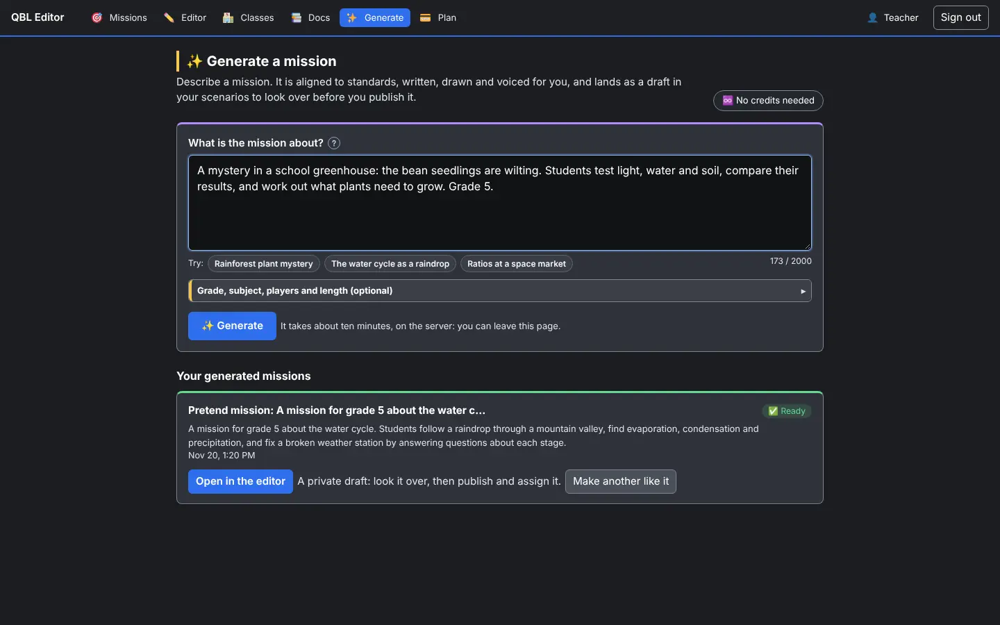
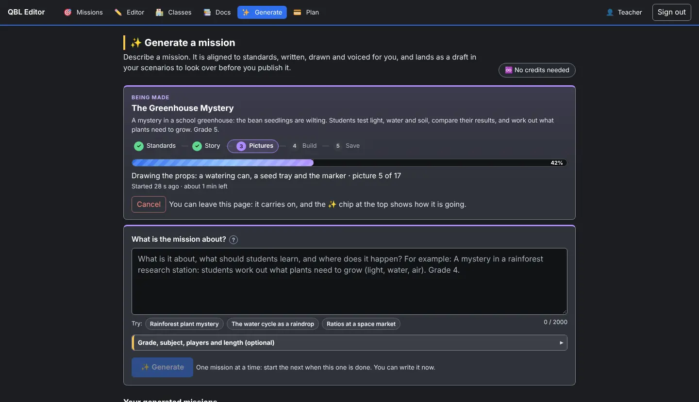

import Flow from '../../../components/diagrams/Flow.astro';

QuestLab has three plans for individuals, and custom plans for schools and districts. The plans are on the **Plans** page (`/plans`, also in the account menu on the missions page); a teacher sees their own under **Plan** in the editor.

Plan | Price | What it includes
---- | ----- | ----------------
Free | $0 | Every free mission, to play
Teacher | $30 a month | Every **curricular** mission, to play and to assign; classes of up to 40 students
Teacher Plus | $50 a month | Everything in Teacher, and the **AI mission generator**, with credits every month
Schools and districts | By quote | Every teacher covered, sign-in through the district (SAML, Clever, Google), roster syncing

Every paid plan starts with a **7-day free trial**, once per account. A **coupon code** can be typed on the Plans page (it says what it gives before you check out) or on Stripe's checkout page. Payment is through Stripe; **Manage billing** opens Stripe's page for the card, invoices and cancelling. Cancelling keeps the plan until the end of the month already paid for.

Buying a teacher plan makes a student account (the kind the sign-in page makes) a teacher's, so the editor and Classes open to it.

## Free and curricular missions

Every mission is either **free** (anyone can play it) or **curricular** (it comes with a teacher plan). Only QuestLab administrators set this, in a scenario's Settings ("Free or curricular").

- A teacher with a plan can play every curricular mission and assign it to their students. Their students play it **through the assignment**: the teacher's plan counts, not the student's.
- Without a plan, a teacher sees curricular missions marked 🔒 on the missions page and in Classes, and cannot assign them. Students do not see them.
- If the teacher's plan ends, missions they assigned close until it is renewed; what the students did is kept.
- A copy of a curricular mission (Duplicate) is curricular too.

A teacher's plan also sets how many students they can add in Classes.

## The AI mission generator

<Flow steps={[
  { who: 'riona', title: 'Standards', text: 'Picks the standards and writes objectives' },
  { icon: '📜', title: 'Story', text: 'Scenes, characters, questions' },
  { icon: '🎨', title: 'Pictures', text: 'Every picture, one house style' },
  { icon: '🧱', title: 'Build', text: 'Events and actions' },
  { icon: '🔊', title: 'Voices', text: 'Every line recorded' },
  { icon: '💾', title: 'Save', text: 'A private draft for you' },
]} caption="The steps the Generate page shows while your mission is made: about ten minutes in all." />

**Generate** in the editor (Teacher Plus, school plans that include it, and administrators; anyone when billing is off): describe the mission (the topic, what students should learn, the setting), and optionally the grade, subject, number of players, minutes and any notes. The **Try** buttons fill in an example to start from. You can also get there from the Scenarios page: **✨ Generate with AI**, or **New scenario** → **Generate it with AI**, which starts the description with the title you typed.

The generator aligns it to curriculum standards, designs the story, scenes, characters and questions, draws every picture in the house style, records the characters' voices, and builds it. That takes about ten minutes, on the server: you can carry on working.

- **On the Generate page** the mission's card shows its steps (Standards, Story, Pictures, Build, Voices, Save), a progress bar, what it is doing right now ("Painting the Greenhouse (scene 3 of 5) · picture 12 of 17") and roughly how long is left.
- **Anywhere else in the editor** a ✨ chip at the top shows the step and percent (and the browser tab shows the percent). Click it to go back to the Generate page.
- **When it is made**, a message says so, with **Open it**. The result is a **private draft** in your scenarios: look it over, then publish and assign it.
- **Cancel** stops it. One still waiting stops at once; one being made stops before its next picture. Either way its credits are given back.
- **Try again** (on one that failed or was cancelled) and **Make another like it** put its description back in the form.

What a generated mission is like: a point-and-click adventure with the learning at its heart. Students carry things in a bag and use them, give them to characters or put them together, and every thing they can pick up helps solve the mission (red herrings are only to look at). Experiments are hands-on instruments with sliders, switches and wheels of chance side by side. Every mission has a twist or turn invented for it, from its place and topic; once in a while (about one mission in four) there is a big tense moment, such as a character slipping off a cliff as students arrive, whom they save with what they find there. Scenes have things to click just to read about, creatures that come and go, characters who stroll about and chat, and, where the place calls for it, a living sky (the sun can set while students work), lanterns and campfires that flicker, beacons that blink and fireflies or falling leaves. Nothing pulses: a small question mark shows what can be clicked. Students are never split into roles; that is left to you.

One mission is made at a time per teacher: you can write the next one while one is being made, and start it when that one is done.

Teachers without the generator see what it is and a link to the plans; on a school license without it, they are asked to talk to whoever runs QuestLab for their school. Administrators also see **Everyone's generations**: the latest 50 by anyone, with who asked and roughly what each spent on AI services.

### Credits

A generated mission costs **10 credits**. Teacher Plus gives **100 credits at the start of each billing month** (20 during the free trial). Credits you do not use **carry over** to the next month, up to **100**; above that they expire when the new month's credits arrive. So the most you can have is 200.

The Generate page shows your balance beside the title, and under the button what you will have left. If a generation fails or you cancel it, its credits are **given back**. One whose server stopped part way (no progress for half an hour) is marked failed and given back too. **Plan** in the editor shows your balance and every change to it. Administrators are not charged.

The numbers above are this site's defaults; the site's administrator can change them.
