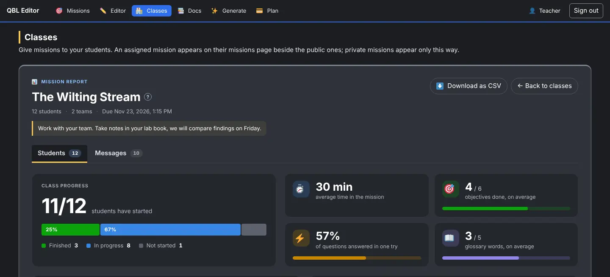
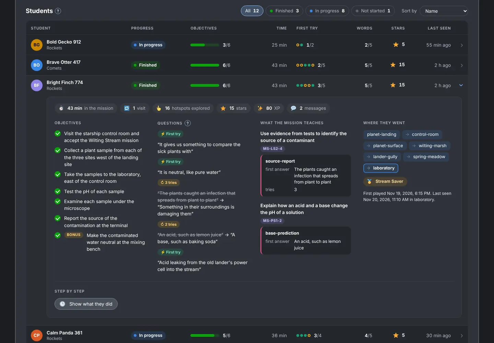

import Host from '../../../components/Host.astro';

import { Aside } from '@astrojs/starlight/components';

The **report** is where a mission pays you back. It shows how a class is doing *while they play*, and afterwards it shows what each student thought, not just whether they finished.

Open it from **Classes → Report** on an assignment's card.

*The top of a report. Eleven of twelve students have started and three have finished.*

## The class at a glance

The first panel answers *"where is everyone?"*

| Tile | What it tells you |
| --- | --- |
| **Class progress** | How many students have started, and the split between **Finished**, **In progress** and **Not started** |
| **Average time in the mission** | Time spent, across visits |
| **Objectives done, on average** | The mean number of the mission's required objectives that students have completed |
| **Questions answered in one try** | The share of questions where the first answer let the student go on |
| **Glossary words, on average** | How many of the mission's words the typical student has collected |

Below the tiles, **Objectives completed** lists each objective in order, with how many students have done it. A step where the bar suddenly shortens is where the class is getting stuck. That is your mini-lesson.

## The students

Below the class panels is a table with one row per student. A **Finished** student has completed every objective that is not a bonus.

| Column | What it is |
| ------ | ---------- |
| **Progress** | Not started, in progress, or finished |
| **Objectives** | Done, of those required. A team's shared progress counts for each of its members |
| **Time** | Time in the mission, across visits |
| **First try** | One dot for each question the student answered, and how many of them were answered in one try (such as *2/5*) |
| **Words** | Glossary words collected |
| **Stars** | Stars earned in this mission |
| **Last seen** | When they last did something |

Use the filters (**All**, **Finished**, **In progress**, **Not started**) and **Sort by** to find who needs you first.

## One student in detail

<Host who="val" side="right">
First answer, then tries. A student who got there on the third try learned something different from one who guessed right first time.
</Host>

Click a name to open the student. This is the most useful part of the report.

*Bright Finch 774, opened. Struck-through answers were tried first; the number of tries is shown for each question.*

- **Objectives**: each one, ticked or not. Bonus objectives are marked.
- **Questions**: every question the student met, with:
  - the **first answer** (what they thought before any feedback),
  - the number of **tries** (*First try*, *2 tries*, *3 tries*),
  - and, where an answer was changed, the earlier answers struck through.
- **What the mission teaches**: where the mission has learning objectives, the evidence the student produced for each: the first answer to the key question and the tries it took.
- **Where they went**: the scenes they visited, in order, and any badge they earned.
- **Step by step**: press **Show what they did** to see the sequence of what they did (scenes entered, hotspots used, answers chosen, objectives completed).

The header chips give time in the mission, visits, hotspots explored, stars, XP and messages sent.

### How to read it

A few quick reads:

| You see | It may mean |
| --- | --- |
| *First try* on every question | They know it, or they are guessing well. Check one answer in conversation. |
| *3 tries* on one question, and others fine | One concept to revisit. |
| The same wrong first answer across many students | A common misconception: teach it. |
| Finished objectives, but very short time | A click-through. Look at the questions' first answers. |
| Many hotspots used, few objectives done | Exploring without direction. Re-frame the task. |
| A long time on one scene | Stuck, or engrossed. Go and ask. |

<Aside type="caution" title="Evidence, not grades">
The report says what students did in the game. Events run in the browser, so it is not tamper-proof (see the trust model on the [protocol](/docs/developers/protocol/) page). Weigh it alongside what you see in the room. **Download as CSV** gives the table for a gradebook; [Maximizing learning](/docs/educators/maximize-learning/#3-use-the-evidence-not-just-the-score) says how to use it well.
</Aside>

## Starting a student again

Sometimes a student needs a fresh start: they rushed through, played on someone else's account, or you want them to try the mission again after a lesson. Open the student in the report and press **↺ Reset progress** at the bottom.

What a reset does:

- **Their saved game in this assignment is deleted.** The next time they open the mission, they start from the beginning. If they are playing at that moment, the game sends them back within about a minute and tells them their teacher reset their progress.
- **What they built is deleted.** Their builds in this assignment's scenes, and the pictures they uploaded for them, go too (see [Student building](/docs/editor/student-building/)).
- **Their notebook is emptied.** What they wrote in their [notebook](/docs/editor/student-notebook/) for this assignment goes with their save.
- **The report counts again from the reset.** Their time, visits, answers and scenes start from zero, and the student shows a line saying when you reset them and who did.

What a reset keeps:

- **The step-by-step log and their messages.** Nothing is erased from the record: *Step by step* shows the reset as a line, with everything before it.
- **Stars, XP and badges.** These belong to the student's account. An award they already got is not given a second time on the replay.
- **What their team did together.** In a team, the world is shared, so a path the team cleared stays cleared and the team's shared objectives stay done.

A reset only touches this assignment. The same student's game in the public mission, or in another class's assignment, is a different save and is not affected. It cannot be undone.

Students cannot reset their own progress, since their save is what this report reads. You can reset yours: see [Testing](/docs/editor/settings-and-publishing/#testing).

## Measuring improvement

The **first answer** per question is the most useful single number. To see change over time:

- compare it between an early mission and a later one on the **same standard**, or
- put the **same question** at the start and the end of one mission (two infoboxes) and compare the two.

## The Messages tab

Next to **Students** is a **Messages** tab. It is the audit log: **every message sent** in the assignment's games, in a scene or privately, with sender, recipient and time. It is there so that chat can be on without being a worry. If a mission needs no chat, switch it off in [Settings](/docs/editor/settings-and-publishing/#settings).

## What is recorded

<Host who="buck" side="left">
Only what happens in the mission, under a pseudonym. Nothing more.
</Host>

The report is read from two places: the save data (time spent, variables, objectives) and the **activity log**, which the game server writes as students play. One line each is logged for: joining and leaving, entering a scene, using a hotspot, choosing an answer in an infobox, completing an objective, getting a glossary word and earning an award. A teacher's reset of a student's progress is a line too. Lines carry the student, their game, the scene and the time.

**Movement and chat text are not in the activity log.** Chat is in the Messages tab.

## Getting reports out of QuestLab

- **Download as CSV** from the report, for a gradebook.
- Your school's systems can read the same data, and more, through the [public API](/docs/api-v1/reports/): grades, per-question answers, standards coverage and an [activity feed](/docs/api-v1/activity-and-privacy-requests/#the-activity-feed).
