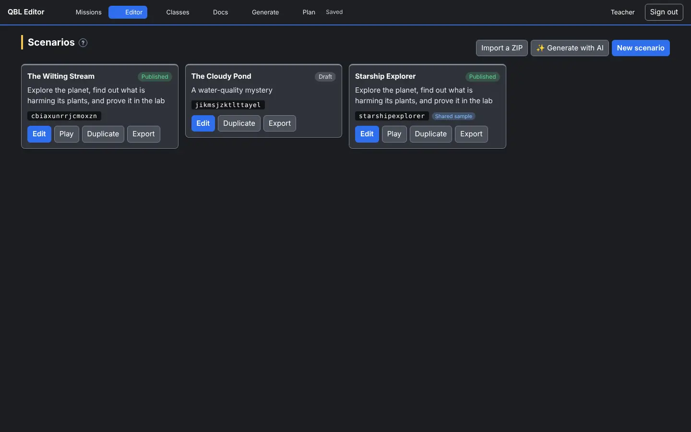
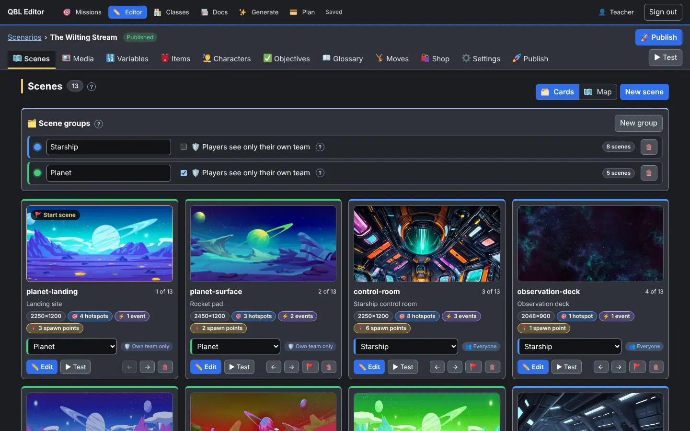

## The scenarios list

The **Editor** page lists every scenario you may edit as a card. Each card shows its title, whether it is a **Draft** or **Published**, and its code, with these buttons:

| Button | What it does |
| ------ | ------------ |
| **Edit** | Opens the scenario |
| **Play** | Opens the published mission in the game (only once published) |
| **Duplicate** | Makes a copy as a new draft of your own |
| **Export** | Downloads the scenario as a ZIP backup |

At the top right are **Import a ZIP** and **New scenario**. Under your own scenarios, **Public missions by others** lists missions other teachers have published for everyone. You cannot change those, but **Make my own copy** gives you a draft of your own to rebuild as you like. The original is not affected.

Duplicating, exporting and importing are described in [Backups, copies and the starship hub](/docs/editor/backups-and-copies/).

### Creating a scenario

**New scenario** asks for a title and how to start:

* **Start aboard the starship** (the default) begins as your own copy of the starship hub: eight rooms, a crew and a marketplace you can change freely. Choose this when your mission is launched from the ship.
* **Start empty** gives one blank scene. Choose this for a self-contained mission, as the [walkthrough](/docs/editor/walkthrough/set-up/) does.

Either way the scenario gets a code of 16 random letters (you can change it on the **Publish** tab) and opens on its **Scenes** page.

:::tip
Teachers also reach this dialog from the **New scenario** button on their missions page, which opens the editor straight into it.
:::

## The Scenes page

The Scenes page shows one card per scene, with its background as a thumbnail, its subtitle, and labels for its size and how many hotspots, other events and spawn points it has. A scene in a group takes the group's colour along the top of its card.

* **New scene** asks for a short name (for example `forest-path`) and opens the new scene.
* **✨ Generate a scene** (also on the map's toolbar) has AI make one from a description: a background painted to match your other scenes, the things standing in it cut out so players walk behind and in front of them, the floor traced so they walk only where they could, and, if you like, things to click that the narrator describes, lights and critters. See [Generate a scene](/docs/editor/plans-and-generator/#one-scene-generate-a-scene).
* Click the thumbnail or **✏️ Edit** to open the [scene editor](/docs/editor/scene-editor/). **▶ Test** plays the draft starting in that scene.
* **←** and **→** change the scene's place in the list. The order is for your own tidiness; players move between scenes only through jump actions.
* **🚩** makes a scene the one players arrive in. The current one is marked **🚩 Start scene** on its thumbnail.
* **📄** duplicates the scene: a copy named `forest-path-copy`, last in the list, with everything in it (its layers, areas, spawn points, placed items and characters, and its hotspots and other events with their actions, conditions and labels). Inside the copy, things that pointed into the scene point into the copy: a hotspot that runs another of the scene's events runs the copy's, and a jump back into the scene itself lands in the copy. Jumps to other scenes still go there, and ways into the original from other scenes still lead to the original, so link the copy in where you want it. It is never the start or intro scene.
* **🗑** removes the scene and everything in it. A scenario always keeps at least one scene.

### Scene groups

Scenes that belong together, such as the rooms of the starship or the places on one planet, can be put in a **scene group** (the card at the top of the page: **New group**). Pick a scene's group on its card. Each group has a colour, shown beside its name and on its scenes' cards. A group has one setting, **Players see only their own team**, for missions a teacher runs with teams: a limited scene shows each player only their teammates, while a meeting place stays open to everyone. A single scene can override its group in its own settings. See [Teams in a scene](/docs/developers/extensions/scenes/#teams-in-a-scene).
