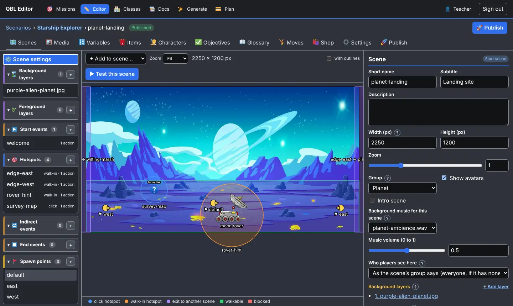
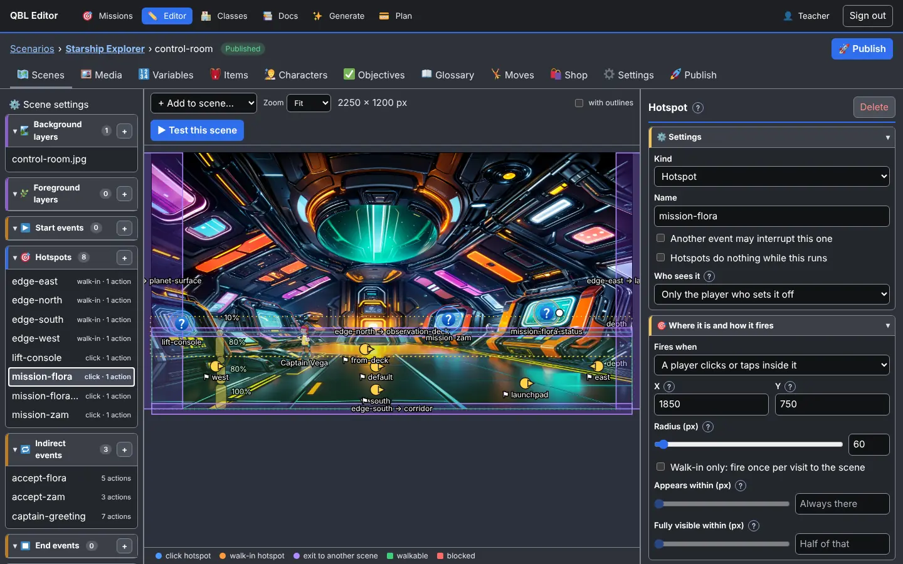

import Host from '../../../components/Host.astro';

import SceneAnatomy from '../../../components/diagrams/SceneAnatomy.astro';

Open a scene from the Scenes page and you get the scene editor: three panes side by side.

| Pane | What it is |
| ---- | ---------- |
| **Left: the outline** | Everything in the scene as folding lists, A to Z. The easy way to find and select something that is hard to click. Each list heading has a **+** to add one |
| **Middle: the canvas** | The scene drawn to scale, with everything in it. Click to select, drag to move |
| **Right: the inspector** | The form for whatever is selected. Choose **⚙️ Scene settings** at the top of the outline to edit the scene itself |

The toolbar above the canvas has **+ Add to scene…**, a **Zoom** list (Fit, or 25% to 200%), the scene's size and the pointer's position in scene pixels, a **with outlines** tick box, and **▶ Test this scene**. A key under the canvas colours the shapes: click hotspots, walk-in hotspots, exits to other scenes, walkable areas and blocked areas.

Coordinates are in **scene pixels**, measured from the top left of the scene. Every position field in the inspector has a marker you can also drag on the canvas, so use whichever is easier.

<SceneAnatomy />

## Adding things

**+ Add to scene…** (or the **+** on an outline heading) puts something new at the middle of what you are looking at, and selects it so its form opens.

| Menu item | What you get |
| --------- | ------------ |
| **Hotspot players click** | A circle that runs its actions when a player clicks or taps inside it |
| **Hotspot players walk into** | A circle that runs its actions when an avatar walks into it |
| **Exit along the left, right, top or bottom edge** | A walk-in hotspot along that edge with a jump action already in it (see below) |
| **Start event**, **End event** | Run on arriving in, and leaving, the scene |
| **Indirect event** | Runs only when another event, or a click on a character, starts it |
| **Spawn point** | A place players can arrive |
| **Item**, **Character** | Something from the [library](/docs/editor/library/) placed in this scene |
| **Walkable area**, **Blocked area** | Where feet may and may not go |
| **Scale area (depth)** | Makes things smaller towards the back of the scene |
| **Shadow spot (shade)** | A patch of shade figures darken in |
| **Light** | A glow that flickers, burns, breathes or blinks: a lantern, a campfire, a beacon |
| **Underwater light** | Light rippling on the floor of a pool or the sea bed, or shafts of light from the surface |
| **Fog** | Soft fog drifting across an outline you draw, or spreading out from a point: mist on a moor, steam from a vent |
| **Background layer**, **Foreground layer** | A picture behind or in front of the avatars |

Items and characters must be defined first on their own pages; if there are none, the editor tells you so.

A scene can also be a **close-up bench**: containers to pour between, a burner, and reactions you write. See [Close-up experiments](/docs/editor/bench/).

## The scene itself

Select **⚙️ Scene settings**. The form has:

* **Short name**, **Subtitle** and **Description**.
* **Width** and **Height** in pixels. A scene larger than the screen scrolls as the avatar walks. Leave them empty to use the background's size. When the first background image is a different size from the scene, a notice offers **Make the scene that size**, which resizes the scene and moves everything in it to match.
* **Zoom**, **Show avatars**, and **Group**.
* **Background music for this scene**, with its volume. Empty uses the scenario's music.
* **Who players see here**, for missions with teams.
* **🌅 Living sky** and **🍃 In the air**: see [A living scene](#a-living-scene).
* **Make this the start scene** and **Delete scene**.

### Layers

A scene's picture is made of **background layers** (behind the avatars, first at the back) and **foreground layers** (in front of them: tree tops, a railing, an arch to walk under). Use **+ Add layer** in the inspector or **Background layer** / **Foreground layer** in the add menu, then choose the image. A layer can be:

* **Stretched** to the scene (the default), or **repeated** at its own size with **Repeat the image at its own size instead of stretching it**.
* Given a **Shown width/height** and an **X/Y** position, to place a picture inside a larger scene.
* Made to **drift** (px per second, right and down) for clouds, water or stars.
* Given a **Parallax** below 1 to move slower than the scene, as if far away. 0 stays put on the screen.
* Marked **Part of the sky** (clouds, a far view), so a living sky tints it with its light.
* Ticked as the **Main picture** (background layers only): the picture shown for the scene on its card in the scenario list (when it is the start scene), on the scene cards and on the scene map. Only one layer can be the main picture; with none ticked, the first background layer is. The outline marks the main picture.

Select a layer in the outline to reorder it with **↑ Further back** and **↓ Further forward**.

### Where players can walk

A scene with no **walkable areas** is walkable everywhere. Add one and players can only walk inside the areas you draw; **blocked areas** cut holes out of them (a table, a pond, a pit). Players click to set a destination and find their own way around blocked areas.

Both are polygons. Drag a corner to move it. A small handle half way along each side adds a corner when you drag it, and **double-click** a corner to remove it. A new walkable area starts as a rectangle you can reshape; a new blocked area is a smaller one.

### Spawn points

A **spawn point** is a named place players can arrive, with an X, a Y and which way they **Face**. The one named `default` is used when a jump names none. Jump actions pick a spawn point of the scene they go to, so name them for where they are on the map: `west`, `east`, `cave-mouth`.

:::caution
Do not put a spawn point inside a walk-in hotspot that jumps, or arriving players would leave again at once. **Publish** refuses it.
:::

### Depth: scale areas and shadow spots

A **scale area** is a box where things are drawn smaller or larger depending on how high up they stand: **Size at the top edge (%)** and **Size at the bottom edge (%)**, with an even change between. A new one covers the walkable part of the scene at 50% to 100%. **Walking speed follows size (%)** decides whether a small, distant figure also walks slower (100 is one to one, 0 ignores size). Outside every box, things are normal size.

A **shadow spot** is a patch of shade on the floor: figures walking through it darken, most at the centre. Place it where your picture already shows shade, and give it a **Radius** and a flatter **Radius up and down**.

### A living scene

A few things make a scene feel alive, drawn by the game itself:

* **🌅 Living sky** (in Scene settings): choose a **Time of day** and the game draws a sky behind your backgrounds, with the sun or the moon and twinkling stars. Choose what it **Slowly becomes** and **Over** how many minutes, and the sky changes while players are there: *Afternoon* to *Dusk* is a sunset through gold, orange, pink and purple into a starry dusk. **Horizon** is where the sun sets, behind your scenery; **Scene takes on its light** tints everything a little warmer at sunset and bluer at night. Your background pictures must be see-through where the sky should show. The canvas shows the sky as players first see it.
* **Lights** (Add › Light): a soft glow you put on a lantern, a campfire, a lit window or a beacon in your picture. Choose **How it moves**: *Flicker* (a flame), *Fire* (a campfire, with embers rising), *Glow* (slowly breathing: crystals, a screen), *Blink* (a beacon) or *Twinkle*, and its **Colour**, **Reach** and **Brightness**. On the canvas each light is a dashed circle; its glow (how far it reaches) shows only while it is selected, so a scene with many lights stays easy to see. Drag it into place and drag its handle to change its reach. Under a living sky, lights shine fully at night and only a little by day. Add conditions under **On only when** to switch a light on and off as the story goes: a beacon that comes on once the ship is repaired, a campfire that goes out when the storm comes. It fades in and out as the conditions start or stop holding. On the canvas, a light with conditions has a ⏻ beside it.
* **🌊 Underwater light** (Add › Underwater light: rippling on the floor, or shafts from above): light under water, drawn live by the game. *Rippling on the floor* is the bright web of light that dances at the bottom of a pool: put its box on the floor in your picture, and it lies behind everyone standing there and lights them too: the ripples play over the avatars, characters and items standing in it. **On people and things** sets how strongly (0 lights only the floor). *Shafts from above* are beams slanting down from the surface, in front of everyone. Choose its **Colour**, **Brightness**, **Size of the pattern** and **Speed**. For ripples, **Floor leans away** makes them smaller toward the top of the box, as a floor seen at an angle; for shafts, **Fan out** spreads them from a point above. It **Fades out** at the edges of its box, or in an oval for a round room or a pool. A floor that is not a rectangle? Under **Shape**, choose **✏️ Give it its own shape**: rippling light gets an outline with eight corners. Drag the corners on the canvas, drag the small handle half way along a side to add a corner (up to 16), and double-click a corner to remove it. The light fades out softly inside the outline. **▭ Back to a box** returns to the box. Shafts always fill their box. The canvas shows it moving, just as players see it. Like a light, it can be **On only when** conditions hold, fading in and out (its name on the canvas then has a ⏻).
* **🌫️ Fog** (Add › Fog): soft, see-through fog drawn live by the game, inside an outline you draw. It starts as a box with four corners: drag the corners on the canvas, drag the small handle half way along a side to add a corner (up to 16), and double-click a corner to remove it; drag the outline to move it. Choose its **Colour** (grey mist, white steam, green swamp gas, dark smoke), its **Opacity** (how much it hides where it is thickest), its **Thickness** (a few wisps or a thick bank), **Wisp size** and **Drift speed**. **Drifts** is to the right, left, up or down, or *Outward from a point* (steam from a vent, smoke from a fire) or *Inward to a point* (drawn into a portal): drag the ✛ on the canvas to choose the point, or **⌖ Back to the middle**. **Drawn** puts it in front of everyone, or on the floor behind them as ground mist. Add as many as you like. Like a light, it can be there **Shown only when** conditions hold, rolling in and clearing slowly as they change (its name on the canvas then has a ⏻). For fog over the whole scene, use the Weather in Scene settings instead.
* **🍃 In the air** (in Scene settings): fireflies, falling leaves, snow, rain, dust in the light or bubbles under water, a few or lots.

Keep it subtle: a few lights where the picture has lights, not everywhere. Players whose device asks for reduced motion see the lights glow steadily, underwater light and fog held still and nothing in the air.

## Exits to other scenes

**Exit along the … edge** is how players get from scene to scene. It creates a walk-in hotspot named `edge-left`, `edge-right`, `edge-top` or `edge-bottom` that spans the whole edge, with one **jump** action that sends players to another scene. Left and right exits sit on the picture's edge; top and bottom exits sit on the edge of the walkable area.

Open the hotspot's action to choose the **Scene** to go to and the spawn point to **Arrive at**. Because an exit is an ordinary hotspot, it can have conditions (a locked gate) and other actions before the jump (a sound, a line of text). The [walkthrough](/docs/editor/walkthrough/schoolyard/#a-gate-that-needs-a-conversation) builds a gate that way.

## Hotspots

<Host who="mallory" side="right">
Hotspots are where the action is. Click one, walk into one, or hide one until the time is right.
</Host>

A hotspot has a position and a **Radius**. Drag its dashed ring on the canvas to change the radius.

* **Fires when**: *a player clicks or taps inside it*, or *a player's avatar walks into it*. A walk-in hotspot fires again each time the avatar leaves and re-enters.
* **X** or **Y** left empty makes the hotspot span the whole width or height, which is how an edge exit works. A **Radius** of -1 covers the whole scene.
* **Walk-in only: fire once per visit to the scene** limits a walk-in hotspot.
* **Appears within (px)** and **Fully visible within (px)** hide a hotspot until the avatar is near, drawn as two dashed rings: far enough and it is invisible and cannot be clicked; between the two distances its labels fade in.

What a hotspot shows, and what it does, is covered in [Events and actions](/docs/editor/events-and-actions/).

## Copy, cut and paste

Select something in the scene (on the canvas or in the list on the left) and use the keys you know (**Cmd** instead of **Ctrl** on a Mac):

| Key | What it does |
| --- | --- |
| <kbd>Delete</kbd> | Deletes it, with no question asked. **Ctrl+Z** (or **Undo** on the message) brings it back. |
| <kbd>Ctrl</kbd>+<kbd>C</kbd> | Copies it. |
| <kbd>Ctrl</kbd>+<kbd>X</kbd> | Cuts it: copies it and deletes it. |
| <kbd>Ctrl</kbd>+<kbd>V</kbd> | Pastes what you copied or cut into the scene that is open, and selects it. |

* **A hotspot** (or a start, end or indirect event) is copied with everything in it: its actions, conditions and labels. Paste it in the same scene and the copy sits a little below and to the right of the original, named `door-2` beside `door`. Open another scene and paste to put it there.
* **Cut and paste moves** a hotspot: pasted the first time, it is the same hotspot with the same actions, so a *Run event* or *Cancel action* elsewhere that pointed at it still does. Paste it again and you get copies.
* **Areas, spawn points, placed items and characters, layers, lights, shadow spots, scale areas, flowing water, underwater light, fog** and the bench's **containers and tools** are copied the same way. A pasted spawn point gets a name of its own.
* With **the scene itself** selected (nothing else), Ctrl+C copies the whole scene, and Ctrl+V pastes a duplicate of it.
* What you copy stays on the editor's clipboard while the page is open, and is pasted only into the same scenario: it uses that scenario's pictures, items and characters. Copying text with Ctrl+C still works as usual where words are selected, and the keys are the field's own while you type in one.

**Actions** are copied and moved between events by ticking them. Each action card has a tick box beside its grip, and the box above the list ticks them all; **Shift+click** a second box to tick the ones between. A bar then offers **Copy**, **Cut** and **Delete**, and the keys do the same. Select another event (or another scene, then its event) and press **Ctrl+V**, or the bar's **📋 Paste** button: the actions go at the end of that event, in the order they were in, with their own conditions. As with hotspots, cut actions are moved, and pasting them again makes copies. Everything pasted, cut or deleted is one step for **Ctrl+Z**.

To copy a whole scene, use **Duplicate scene** at the bottom of the scene's settings (or the 📄 on its card on the Scenes page, or Ctrl+C and Ctrl+V on the [map](/docs/editor/scene-map/)).

## Characters and items in a scene

<Host who="pinta" side="left">
That's me! Place a character, point them the right way, and choose what happens when someone clicks.
</Host>

A placed **character** has a position, a **Facing**, and **When clicked, run**, a list of this scene's indirect events. That is how conversations start. A placed **item** has a position and is drawn like any object: players walk behind it and in front of it.

## Testing from here

**▶ Test this scene** opens the game on your unpublished draft, in this scene, with you alone and nothing saved. Tick **with outlines** first to draw hotspots, walkable areas and positions over the game, which is the quickest way to see why a hotspot does not fire.
