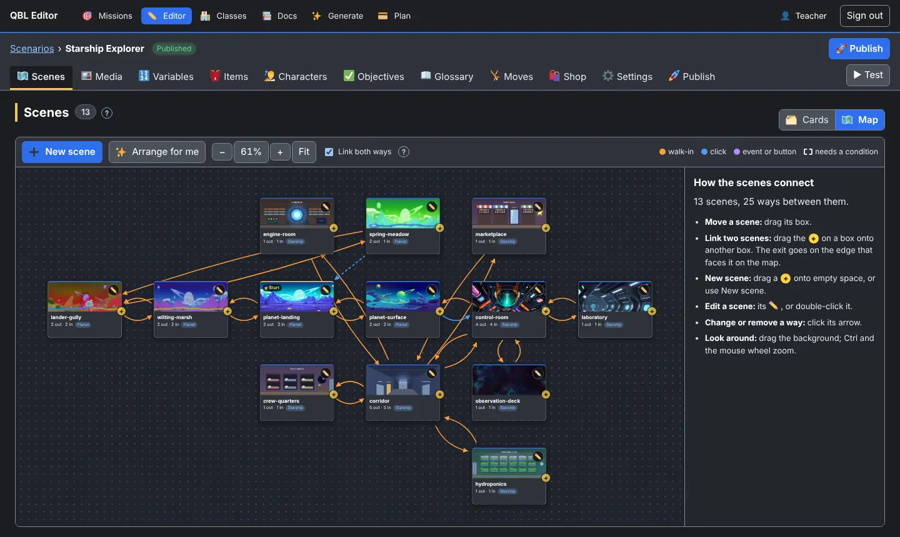

import { Aside } from '@astrojs/starlight/components';

Once a mission has more than a few scenes, a list of cards stops telling you how it hangs together. The **scene map** shows every scene as a box and every way between scenes as an arrow, so you can see the shape of the mission, spot a scene that nobody can reach, and draw new exits by dragging.

*The Starship Explorer sample on the map: 13 scenes and 25 ways between them.*

## Open it

On a scenario's **Scenes** tab, use the **Cards | Map** switch at the top right. The editor remembers your choice in this browser. The cards view is unchanged.

## What you see

- Each **box** is a scene: its background, its name, how many ways go **out** and **in**, and its scene group (the coloured tag). The **Start** flag marks the scene players arrive in.
- Each **arrow** is a way between scenes. They read every jump in the mission: exits along an edge, click hotspots, start, end and indirect events, and even a jump hidden inside an infobox button.
- The **colour** of an arrow says how a player takes it:

  | Colour | How the player goes |
  | --- | --- |
  | Orange | Walks into it |
  | Blue | Clicks it |
  | Purple | An event or a button does it |

- A **dashed** arrow is **guarded by a condition**: a locked gate, an exit that opens later.
- Two scenes that connect both ways get two arrows that curve apart.

## What you can do

| To… | Do this |
| --- | --- |
| **Move a scene** | Drag its box. Boxes snap to a 20-pixel grid. With a box focused, the arrow keys move it. |
| **Link two scenes** | Drag the yellow **+** on one box onto another box. An exit is made on the edge that faces the other box on the map. |
| **Make a new scene and link it** | Drag a **+** onto empty space. The editor asks for a name, makes the scene there and links it. |
| **Edit a scene** | Click the ✏️ on its box, or double-click it. (With a box focused, press <kbd>Enter</kbd>.) |
| **Change or remove a way** | Click its arrow. The side panel shows where it goes, which spawn point it arrives at, and buttons to open it in the scene editor, remove it or add the way back. |
| **Look around** | Drag the background to pan. <kbd>Ctrl</kbd> and the mouse wheel zoom. **Fit** shows everything. |
| **Tidy up** | **Arrange for me** lays the scenes out from the start scene, each one beside the edge that leads to it. |

**Link both ways** (on by default) makes the return exit as well, so one drag builds a two-way door. Untick it for a one-way drop.

The side panel gives you an overview when nothing is selected: the counts, any **scenes nobody can reach**, any **exits that go nowhere**, and the instructions above. Click a scene for its details: edit, test, make it the start scene, set its group, and a list of its ways out and in.

## What a link really is

A link made on the map is not special. It makes the same **walk-in edge hotspot** with one jump action that **Exit along the left, right, top or bottom edge** makes in the [scene editor](/docs/editor/scene-editor/#exits-to-other-scenes), on the edge facing the other box, and arrives at the target scene's spawn point nearest the opposite edge. If that edge is taken it uses the next free one; if all four are taken it makes a click hotspot in the middle of the scene.

That means you can open the hotspot afterwards and add what a real door needs: a condition, a sound, a line of text before the jump. **Open in the scene** from the arrow's panel takes you straight to it.

Removing a way deletes the hotspot only if all it did was jump. If it did anything else, the hotspot stays and only the jump goes.

<Aside type="note" title="Where the positions are kept">
A scene's place on the map is saved with the scene, as `params.editor_map` (`x` and `y`). It travels with an exported ZIP, and the game ignores it. Moving a box counts as a change, so the scenario shows **Unpublished changes**. The map is built for a desktop browser; it is not laid out for phones.
</Aside>

## When to use the map

- **Planning**: make the scenes first with **New scene**, then link them on the map to see the shape before you fill them in.
- **Checking**: look for scenes with no arrows in, and arrows that go nowhere. The overview panel lists both, so you do not have to hunt.
- **Teaching**: a mission map is a good picture to show a colleague or a class.
