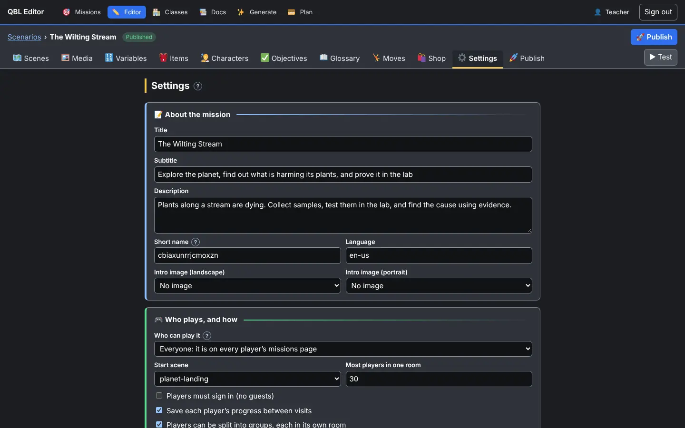
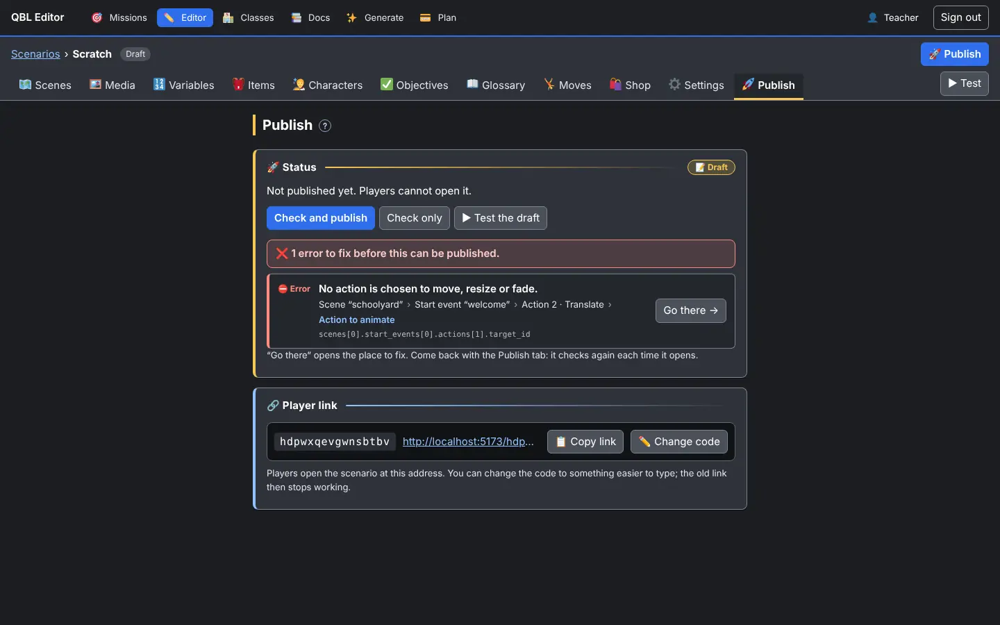

import Flow from '../../../components/diagrams/Flow.astro';

## Settings

The **Settings** tab holds what applies to the whole scenario, in sections: **About the mission**, **Who plays, and how**, **Talking and reading**, **Music** and **Advanced**.

| Setting | What it does |
| ------- | ------------ |
| **Title**, **Subtitle**, **Description** | What players see on the mission's card |
| **Start scene** | Where players arrive |
| **Most players in one room** | A limit on how many play together. Empty means no limit |
| **Language**, **Short name** | A language tag and a readable name. Players use the scenario's code, not the short name |
| **Save each player's progress between visits** | On by default |
| **Players must sign in (no guests)** | On by default |
| **Background music** and **Music volume** | Plays in every scene that does not have its own |
| **Who can play it** | *Everyone* (it is on every player's missions page) or *Only students it is assigned to* |
| **Chat** | *Off*, *Emotes only* or *Typed messages (filtered)* |
| **Players can send each other private messages** | Filtered like chat; every message is kept and a teacher can read them on the Classes page |
| **Read text aloud** | *Everything*, or *Only where an action says so* |
| **Walking speed** | Pixels per second |

**Who can play it** applies as soon as you change it, without publishing. A *private* mission appears only for the students it was assigned to, and only its owner can assign it; see [Classes, missions and teams](/docs/editor/classes/).

At the bottom of the page are **Export as a ZIP**, **Duplicate**, and **Delete this scenario**, which asks you to confirm and then removes its scenes and every player's saved progress in it. See [Backups, copies and the starship hub](/docs/editor/backups-and-copies/).

## Testing

**▶ Test** (in the tab bar, on each scene card, and in the scene editor) opens the game on your **unpublished draft**:

* You play **alone**, and **nothing is saved**, so you can test as often as you like.
* From the scene editor it starts **in that scene**, which saves walking there.
* In the scene editor, **with outlines** draws hotspots, walkable areas and positions over the game.

Test on the draft before publishing, and again after publishing as a student in another browser. Testing never touches what players have.

When you play a **published** mission yourself (from the missions page, or by looking in on a class), your game is saved like anyone's. To try it again from the beginning, choose **🔄 Start this mission again** in your menu (top right, in the game), or press **Start again** on the mission's card on the missions page. It deletes only your own saved game in that copy of the world. Your stars, XP and badges stay, and your students' games are not touched. To start a *student* again, see [Starting a student again](/docs/editor/reports/#starting-a-student-again).

## Publishing

<Flow loop="Change and publish again: players keep the last version until you do" steps={[
  { icon: '✏️', title: 'Draft', text: 'Only you see your changes.' },
  { icon: '▶️', title: 'Test', text: 'Play it as a student. Nothing is saved.' },
  { icon: '🔍', title: 'Check', text: 'Errors stop the publish; Go there → takes you to each.' },
  { icon: '🚀', title: 'Publish', text: 'Players get the new version.' },
]} />

Players get the **published** version. Until you publish again, they keep the last one, however much you have edited since. Press **🚀 Publish** (on every page) or use the **Publish** tab:

1. **Check and publish** runs the same validator the game uses over what you have built.
2. **Errors** stop publishing, for example a condition that uses a variable you have not defined, an objective with no condition that ticks it off, or a Translate action with no action chosen to animate. Fix them and publish again.
3. **Warnings** do not stop publishing but are worth a look.
4. On success, players get the new version at once.

Each problem says where it is, from the outside in: for example *Scene “Pond” › Start event “Arrive” › Action 1 · Translate › Action to animate*. The last part, in blue, is the field to change. **Go there →** opens that place: the scene editor with the event selected, the action open and the field lit up, or the picture's or character's panel, or the page the problem is on. Below each problem, in small type, is its path in the scenario's JSON, for anyone reading the JSON itself.

The Publish tab checks the scenario each time it opens, so after a fix, click **Publish** in the tabs to see what is left. If **🚀 Publish** finds errors, it takes you there.

**Check only** lists errors and warnings without publishing, and **▶ Test the draft** plays the draft.

The Publish tab also shows the **Player link** with a **Copy link** button. The code in it is the scenario's address. It stays the same through every republish, so a link you have shared keeps working.

**✏️ Change code** replaces the 16 random letters with a code that is easier to type, such as `cloudy-pond`: 4 to 32 lowercase letters, digits and hyphens, starting with a letter. It must not be in use by another scenario or be one of the site's own addresses (`missions`, `editor`, `docs` and so on). The new code works at once, whether or not the scenario is published, and it does not count as an unpublished change. **The old code stops working**: anyone with the old link, students in your classes included, needs the new one. Assignments and saved progress are kept. Only an admin can change the code of a shared sample. The badge in the header says where you are: **Draft** (never published, so players cannot open it), **Unpublished changes**, or **Published**.

## Getting the mission to students

* A **public** mission is on every student's missions page once published.
* A **private** mission, or one you want to give a due date or teams, is **assigned** from **Classes**. Add your students by email, choose **Assign a mission**, and optionally set a due date, a note and teams.
* Use **Look in** to join a team's game as yourself, and **Report** to see how students are doing.

All of this is in [Classes, missions and teams](/docs/editor/classes/).
