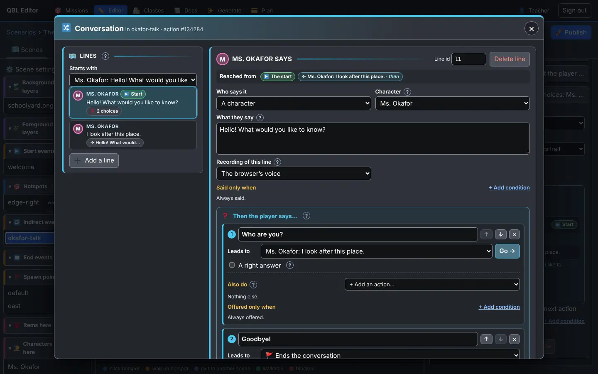
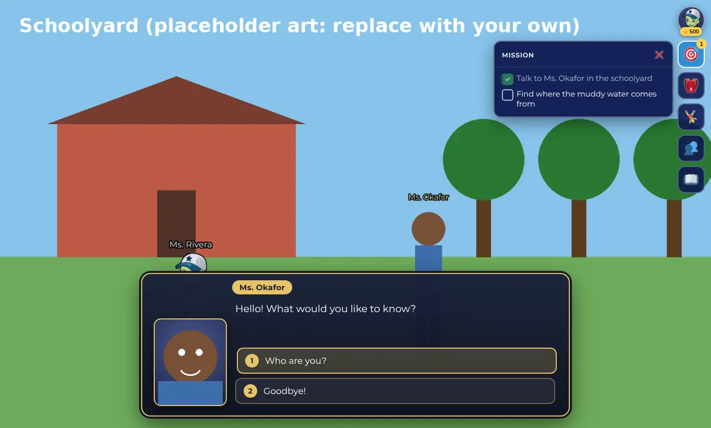

import { Steps, Aside } from '@astrojs/starlight/components';

The mission you built works, but it still *tells* more than it *asks*. Three small upgrades change that, and each one gives you something to talk about when the class gets back together:

1. **A conversation** in place of Ms. Okafor's two lines, so the student chooses what to ask.
2. **A prediction** before the pond, so every student commits to an idea first.
3. **The prediction read back** when they find the answer, so they can see whether they were right.

You need the finished mission from parts 1 to 4. Open it again in the editor, and test your changes as you go.

## 1. Swap the lines for a conversation

<Steps>

1. Open the `schoolyard` scene and select the indirect event `okafor-talk`.

2. Delete the two 💬 **Dialogue** actions (actions 2 and 3). Keep the two ✋ **Freeze or release player** actions and the 🔢 **Variable** action.

3. Between the first freeze and the variable, add a 🔀 **Conversation** action. Leave **Shown as** on the story box with the speaker's portrait.

   The event is now: freeze, conversation, set `mission_started` to `1`, release. The conversation waits until it is over, so the variable is only set after the student has finished talking.

4. Press **Edit the conversation**. A new conversation starts as a small tree. Reshape it into three lines, each said by Ms. Okafor:

   | Line | Who says it | What they say |
   | ---- | ----------- | ------------- |
   | `l1` (the start) | Ms. Okafor | `The pond used to be so clear. Now it looks like chocolate milk! Can you find out why, {{QL_PlayerName}}?` |
   | `l2` | Ms. Okafor | `Muddy water is not always dirty water. It is carrying something. Look for where it comes from.` |
   | `l3` | Ms. Okafor | `Head east to the pond. Look for anything that does not belong.` |

   On `l1`, under **Then the player says…**, set the choices:

   | The player's words | Leads to |
   | ------------------ | -------- |
   | `Why is the water brown?` | `l2` |
   | `I will go and look.` | `l3` |

   On `l2`, add one choice: `I will go and look.`, leading to `l3`. On `l3`, leave **Then go on to** at *Ends the conversation*.

   A student who asks first gets a clue; a student who is keen skips it. Both end up at `l3`, and both leave with `mission_started` set.

</Steps>

Press **▶ Test this scene** and click Ms. Okafor. Click on from her line, and your choices appear in a box of your own.

<Aside type="tip">
You could also set `mission_started` from the choices (**Also do** on each one) instead of after the conversation. Doing it afterwards is the simpler version, and it means the pond stays closed until the talk is really over.
</Aside>

*How the same conversation looks to the student.*

## 2. Ask for a prediction

A prediction changes what a student does at the pond: they are no longer collecting facts, they are testing an idea they have already said out loud. It also tells *you* what they thought before they saw anything.

<Steps>

1. On the **Variables** tab press **New variable**: **Name** `prediction`, **Whose it is** *Each player has their own*, **Kept between visits** on. This is where the student's words will be saved.

2. In the `okafor-talk` event, add a 📋 **Infobox** after the 🔀 **Conversation** action (and before the variable). Write:

   `<h3>Before you go</h3>
What do you think is making the water muddy? Write your best guess.
`

3. Insert an **✏️ Answer box** that saves to `prediction`.

4. Add two buttons, *I'll check it out* and *I'm not sure*, each leaving the action as *Just close the box*. Untick **Can be closed without choosing a button**, so every student answers.

</Steps>

The first button waits until something has been typed; *I'm not sure* takes whatever is there. A student who writes nothing is still choosing to say they are unsure, which is worth knowing too. See [Answer boxes](/docs/editor/infoboxes/#answer-boxes) for how the box saves its text.

## 3. Read it back

When the student finds the source, they should see what they predicted next to what they found.

<Steps>

1. Open the `pond` scene and the indirect event `answer-road`.

2. In its last action, the 📋 **Infobox**, change the **Content** to:

   `<h3>That is it!</h3>
You predicted: <i>{{prediction}}</i>

When it rains, water runs off the road, picks up soil, and pours into the pond through this pipe. The mud is <b>sediment</b>, carried by <b>runoff</b>.
`

   Use the 🔢 **Variable** chip from **＋ Insert**, or type `{{prediction}}` yourself.

</Steps>

Test it end to end: talk to Ms. Okafor, type a guess, go to the pond, choose a wrong answer, then the right one. The last box shows the student's own words.

## What to do with it in class

The prediction is in the [class report](/docs/editor/reports/), beside the button the student pressed. Use it:

* **Before the pond**, ask a few students to read their predictions aloud. Do not say who is right.
* **After the pond**, ask: *Did anyone's idea change? What made it change?* A student who predicted "the ducks" and then found the pipe has a real story to tell.
* **Next time**, set the same question at the start of a different mission and compare. See [Maximize learning](/docs/educators/maximize-learning/) for more on revisiting and measuring improvement.

## Where to go from here

You have used every part of the editor: scenes, characters, hotspots, events, conditions, variables, infoboxes, conversations, rewards, a glossary and objectives. To keep going:

* [Patterns](/docs/editor/patterns/) lists ready-made ways to build keys and gates, questions, scoring, and more.
* [Design for learning](/docs/educators/design-for-learning/) is about what to write, not how to build it.
* [Ideas for educators](/docs/educators/ideas/) has twelve missions to start from.
