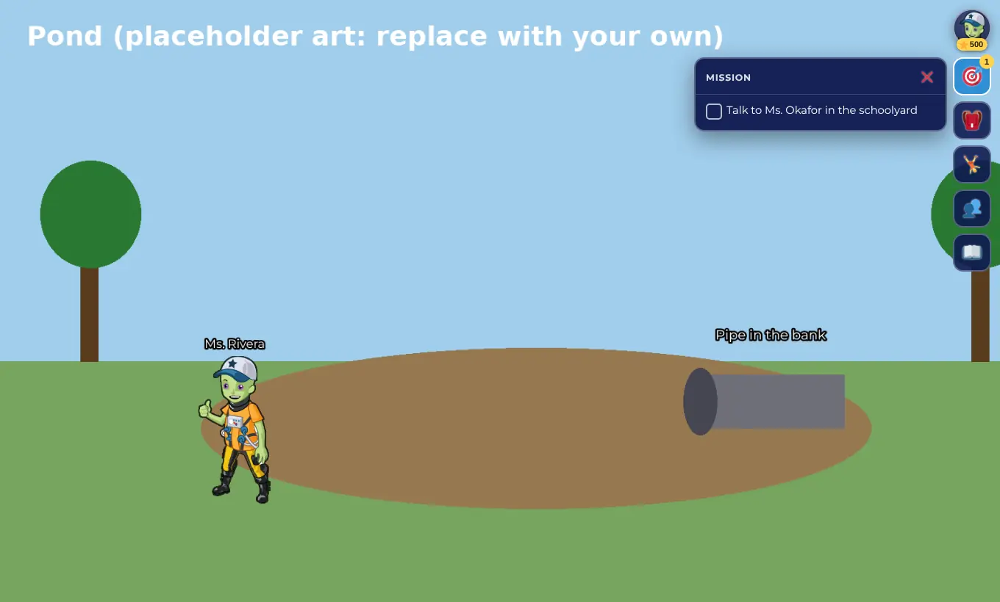

import { Steps, Aside } from '@astrojs/starlight/components';

The pond has one job: a pipe pouring muddy water in. Clicking it asks where the mud comes from. One answer is right; two teach by explaining why they are wrong.

## Draw the pond



*The pond as a student sees it. The label tells them where to click.*

Go to the **Scenes** tab and open `pond`.

<Steps>

1. Select **⚙️ Scene settings**. Add a background layer with `pond.png` and press **Make the scene that size** (1600 × 900).

2. Add a **Walkable area** and drag its corners to the same shape as the schoolyard's: `(0, 600)`, `(1600, 600)`, `(1600, 900)`, `(0, 900)`. The pond picture's water is above that line, so students walk along the bank and not through the water.

3. Add a **Spawn point**. It is named `default`; drag it to `(350, 760)`. Add another named `west` at the same place. The exit from the schoolyard arrives at `west`.

   <Aside>
   Two spawn points at one spot may look redundant. `default` is what the game uses when no spawn point is named (for example when you press ▶ Test here), and `west` says what the schoolyard's exit means. Naming spawn points for where they are keeps jumps easy to read later.
   </Aside>

4. Choose **Exit along the left edge** from **+ Add to scene…**. Open its jump action, set **Scene** to `schoolyard` and **Arrive at** to `east`. No conditions: students can always go back.

</Steps>

Return to the schoolyard and check its exit's jump now offers **Arrive at**: `west`. If you left it empty earlier, set it.

## Write the three answers

The question is built from three indirect events, one per answer, and one hotspot that asks it. Build the answers first so the hotspot's buttons can point at them.

<Steps>

1. Add an **Indirect event** named `answer-road` (the right answer). Give it these actions, in order:

   | # | Action | Settings |
   | - | ------ | -------- |
   | 1 | 🔢 **Variable** | `found_source` *Set to* `1` |
   | 2 | ⭐ **Award stars or XP** | **Stars** `5`, **XP** `20`, **Shown with the award** `Found the source of the mud`, **Badge that comes with it** `Pond Detective`, **What the badge is for** `Traced muddy water back to where it started`. Untick **Wait for this to finish** |
   | 3 | 📖 **Add a glossary word** | **Word**: Runoff |
   | 4 | 📋 **Infobox** | **Content**: `<h3>That is it!</h3><p>When it rains, water runs off the road, picks up soil, and pours into the pond through this pipe. The mud is <b>sediment</b>, carried by <b>runoff</b>.</p>` |

   The award is in this event rather than on a button, as the award note recommends. Each student is paid once however many times the event runs.

2. Add an **Indirect event** named `answer-ducks` with one action, 📋 **Infobox**:

   `<h3>Not quite</h3><p>Ducks stir up a little mud, but the water is muddiest right where the pipe empties. Click the pipe and try again.</p>`

3. Add an **Indirect event** named `answer-bottom` with one action, 📋 **Infobox**:

   `<h3>Not quite</h3><p>The mud is thickest near the pipe and thins out across the pond, so it is coming in from outside. Click the pipe and try again.</p>`

</Steps>

## The question

<Steps>

1. Choose **Hotspot players click** from **+ Add to scene…**. Name it `storm-drain`. Drag it onto the pipe, about `(1150, 620)`, and set the **Radius** to `100` (drag the dashed ring, or type it).

2. Under 🔀 Conditions add `found_source` `=` `0`. Once the student has found the source, the pipe stops being a hotspot, and its label disappears with it.

3. Under 🏷️ Labels press **+ Add label**: **Kind** *Text*, **Text** `Pipe in the bank`, and drag it just above the pipe (about `(1150, 500)`). Players see this and know where to click.

4. Under 🎬 Actions add one action, 📋 **Infobox**:

   | Field | Value |
   | ----- | ----- |
   | **Content (HTML)** | `<h3>Muddy water</h3><p>Brown water is pouring out of a pipe in the bank. Where do you think it comes from?</p>` |
   | **Can be closed without choosing a button** | **unticked** |

   Unticking is what makes it a question: the student has to choose an answer.

5. Under **Buttons**, press **+ Add button** three times. For each, type the button text, then set its action to **Run event** and choose the event:

   | Button text | Run event |
   | ----------- | --------- |
   | `From the road above the pond` | `answer-road` |
   | `From the ducks` | `answer-ducks` |
   | `From the bottom of the pond` | `answer-bottom` |

</Steps>

<Aside type="note" title="Checkpoint">
The pond's outline should list **Hotspots** 2 (`edge-left` and `storm-drain`), **Indirect events** 3, **Spawn points** 2 and **Walkable areas** 1. On the **Glossary** tab, Runoff's card should now say *Given by 1 action*.
</Aside>

## What you built

Here is how the finished question reads in the scenario JSON. This is the pipe hotspot, trimmed to the interesting parts (the editor adds ids and sequence numbers that are left out here):

```json
{
  "shortname": "storm-drain",
  "position_x": 1150, "position_y": 620, "radius": 100,
  "activate_by_trigger": true,
  "conditions": [{ "variable": "found_source", "operator": "=", "operand": 0 }],
  "labels": [{ "type": "text", "text": "Pipe in the bank", "position_x": 1150, "position_y": 500 }],
  "actions": [{
    "type": "infobox",
    "dismissible": false,
    "content": "<h3>Muddy water</h3><p>Brown water is pouring out of a pipe…</p>",
    "call_to_actions": [
      { "text": "From the road above the pond", "action": { "type": "run_event", "target_event_id": 22 } },
      { "text": "From the ducks",               "action": { "type": "run_event", "target_event_id": 23 } },
      { "text": "From the bottom of the pond",  "action": { "type": "run_event", "target_event_id": 24 } }
    ]
  }]
}
```

And the schoolyard's gate, with its two conditioned actions:

```json
{
  "shortname": "edge-right",
  "position_x": 1600, "position_y": null, "radius": 120,
  "activate_by_trigger": false,
  "actions": [
    { "type": "text_overlay", "text": "Talk to Ms. Okafor before you head to the pond.",
      "alignment": "top center", "duration": 3000,
      "conditions": [{ "variable": "mission_started", "operator": "=", "operand": 0 }] },
    { "type": "jump", "scene_id": 2, "spawn_point": "west",
      "conditions": [{ "variable": "mission_started", "operator": "=", "operand": 1 }] }
  ]
}
```

A `null` position means the hotspot spans that whole axis, which is what makes it an edge. See [Events](/docs/developers/event/), [Actions](/docs/developers/action/) and [Runtime extensions](/docs/developers/extensions/) for every field.

Finally, [test it, publish it and assign it](/docs/editor/walkthrough/publish/).
