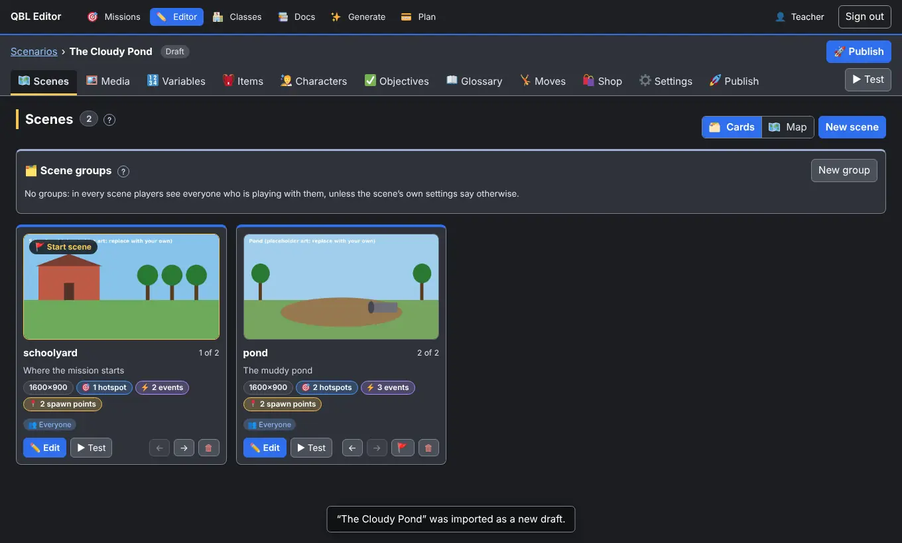
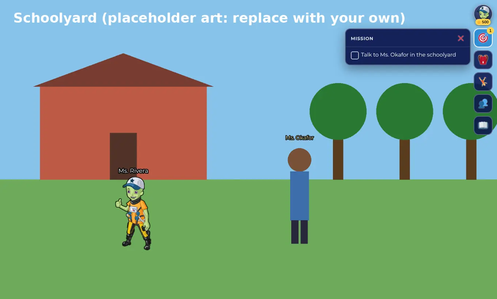

import { Steps, Aside } from '@astrojs/starlight/components';

The schoolyard is where the mission starts. Ms. Okafor stands in the yard; talking to her sets `mission_started` to `1`, which is what lets the student through the gate to the pond.

## Create both scenes first

*After this step, the Scenes tab lists both.*

The gate will jump to the pond, so the pond has to exist before you build it. Go to the **Scenes** tab.

<Steps>

1. Open the scene that is already there (**Edit**). Select **⚙️ Scene settings** and set its **Short name** to `schoolyard`. Go back to **Scenes**.

2. Press **New scene**, type `pond`, and press OK. It opens in the scene editor. Use the **Scenes** tab to go back, and open `schoolyard` again.

</Steps>

## Draw the schoolyard

*The schoolyard as a student sees it when the mission starts (with placeholder art: swap in your own).*

<Steps>

1. Select **⚙️ Scene settings**. Under **Background layers**, press **+ Add layer** and choose `schoolyard.png` as its **Image**.

2. A notice appears: *The first background image is 1600 × 900 px.* Press **Make the scene that size**. The scene is now 1600 × 900 and the picture fills it.

3. Choose **Walkable area** from **+ Add to scene…**. A rectangle appears in the middle. Drag its four corners so it covers the grass: top edge at about y = 600, running to the bottom and across the full width. Watch the coordinates in the toolbar as you drag. The result should be roughly the corners `(0, 600)`, `(1600, 600)`, `(1600, 900)` and `(0, 900)`.

   <Aside>
   Players can walk only inside walkable areas. If you left the scene without one, they could walk over the roof of the school.
   </Aside>

4. Choose **Spawn point** from **+ Add to scene…**. The first one is named `default`. Drag it to about `(400, 760)`, on the grass on the left. This is where players arrive when they start the mission.

5. Add a second spawn point. Name it `east`, set **Facing** to *Left*, and drag it to about `(1250, 760)`. This is where players arrive when they come back from the pond.

   <Aside type="caution">
   Keep `east` well clear of the right-hand edge. The exit you build below covers 120 pixels from that edge, and arriving inside it would send the player straight back.
   </Aside>

</Steps>

## Place Ms. Okafor

<Steps>

1. Choose **Character** from **+ Add to scene…**. Because there is only one character, she is placed. Drag her to about `(900, 740)` and set **Facing** to *Left*, so she faces the student coming in.

2. Leave **When clicked, run** empty for now. You will point it at her conversation in a moment.

</Steps>

## Write her conversation

A conversation is an **indirect event**: it does nothing until a click on the character starts it.

<Steps>

1. Choose **Indirect event (run by other events)** from **+ Add to scene…**. In its inspector set the **Name** to `okafor-talk`.

2. Under 🎬 Actions, press **+ Add action…** and add these five actions, in this order:

   | # | Action | Settings |
   | - | ------ | -------- |
   | 1 | ✋ **Freeze or release player** | **The player**: *Cannot move* |
   | 2 | 💬 **Dialogue** | **Shown as**: *A story box with the speaker's portrait*. **Who speaks**: *A character*, **Character**: Ms. Okafor. **What they say**: `The pond used to be so clear. Now it looks like chocolate milk! Can you find out why, {{QBLPlayerName}}?` |
   | 3 | 💬 **Dialogue** | Same settings. **What they say**: `Head east to the pond. Look for anything that does not belong.` |
   | 4 | 🔢 **Variable** | **Variable**: `mission_started`. **Change**: *Set to*. **Value**: `1` |
   | 5 | ✋ **Freeze or release player** | **The player**: *Can move again* |

   `{{QBLPlayerName}}` is replaced with the student's name when the line is shown.

   <Aside>
   The freeze keeps the student from wandering off while Ms. Okafor talks. A freeze always ends when its event finishes, so even if you forgot action 5 nobody would be stuck, but release explicitly when you can.
   </Aside>

3. Now select Ms. Okafor on the canvas (or under **Characters here** in the outline). Set **When clicked, run** to `okafor-talk`.

</Steps>

## A welcome message

A **start event** runs when a player arrives. This one greets a new student, and then goes away once they have talked to Ms. Okafor.

<Steps>

1. Choose **Start event (runs on arrival)** from **+ Add to scene…**. Set its **Name** to `welcome`.

2. Under 🔀 Conditions, press **+ Add condition** and set `mission_started` `=` `0`. This event now runs only for a student who has not yet started.

3. Add one action, 🔤 **Text overlay**:

   | Field | Value |
   | ----- | ----- |
   | **Text** | `Walk with the arrow keys or by clicking. Say hello to Ms. Okafor.` |
   | **Where** | *top center* |
   | **Duration (ms)** | `5000` |

</Steps>

## A gate that needs a conversation

The path to the pond should open only after Ms. Okafor has spoken. The right edge of the schoolyard is the exit, and a **conditioned action** does the locking.

<Steps>

1. Choose **Exit along the right edge** from **+ Add to scene…**. A message appears: *Players who walk off the right edge go to "pond"*. The editor has made a walk-in hotspot named `edge-right` along the right edge, with one **Jump** action pointing at the pond.

2. Open the jump action. Check that **Scene** is `pond` and set **Arrive at** to `west` (you will create that spawn point in the next part; if the list is empty, come back to this after building the pond).

3. Under the jump's **Only when**, press **+ Add condition** and set `mission_started` `=` `1`. A student who has not met Ms. Okafor now walks into the edge and nothing happens.

4. Nothing happening is confusing, so add a hint. Press **+ Add action…** and choose 🔤 **Text overlay**:

   | Field | Value |
   | ----- | ----- |
   | **Text** | `Talk to Ms. Okafor before you head to the pond.` |
   | **Where** | *top center* |
   | **Duration (ms)** | `3000` |
   | **Only when** | `mission_started` `=` `0` |

   Drag the ⠿ grip so this action is **first**, above the jump.

</Steps>

The exit now does one of two things. A student who has not spoken to Ms. Okafor sees the hint and the jump is skipped. A student who has gets no hint and is sent to the pond. Because the exit is a walk-in hotspot it fires again whenever the avatar re-enters it, so the hint comes back if they try again.

<Aside type="note" title="Checkpoint">
The outline should list: **Background layers** 1, **Start events** 1 (`welcome`), **Hotspots** 1 (`edge-right`), **Indirect events** 1 (`okafor-talk`), **Spawn points** 2, **Characters here** 1, **Walkable areas** 1. Press **▶ Test this scene** with **with outlines** ticked to see them over the game. Walking into the right edge should show the hint (it cannot jump yet if the pond has no spawn point).
</Aside>

Next, [the pond](/docs/editor/walkthrough/pond/).
