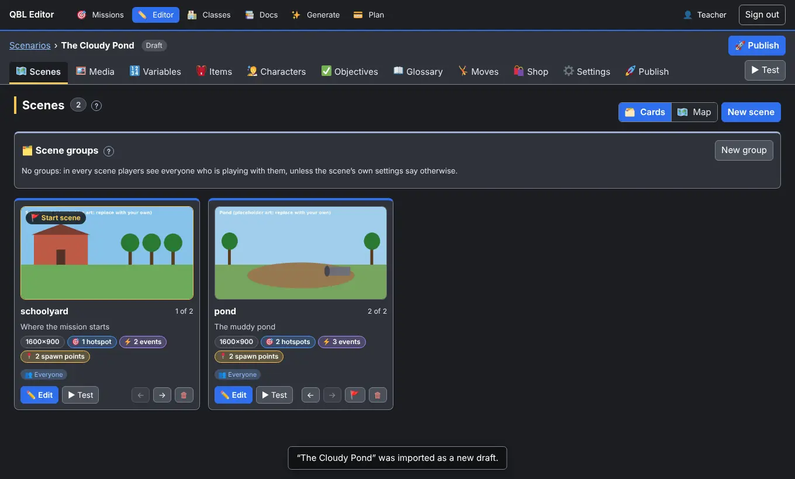
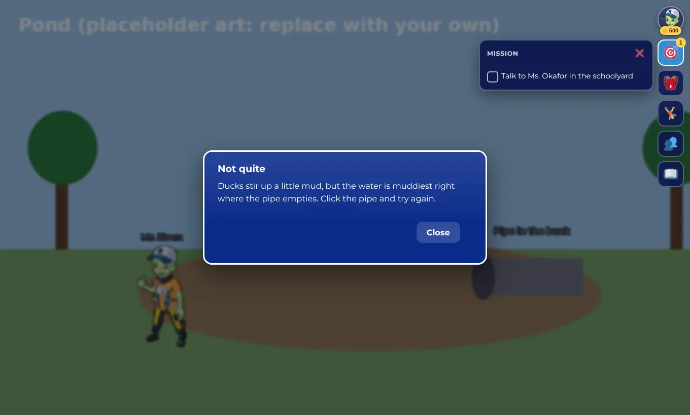

import { Aside, Steps, Tabs, TabItem } from '@astrojs/starlight/components';

The [editor pages](/docs/editor/) show *how* to make a hotspot, a conversation or a question. This page is about *what to make*: the choices that turn a pretty place with questions in it into something students learn from.

You do not need to be a game designer. You need to be a teacher who asks, for each thing in the mission, **"what would a student think or do here?"**

## Start from the debrief

Before you open the editor, write down **one sentence** you want every student to be able to say at the end:

> *"The plants are being harmed by acid leaking from the old lander, and I know because the soil tests near it were more acidic than elsewhere."*

Then work backwards:

<Steps>

1. **What evidence leads to that sentence?** (pH readings at several places, a healthy comparison plant.) Each piece is a thing students must find or do.

2. **What must students understand to use the evidence?** (the pH scale, what "acidic" means.) Each is a concept the mission explains or asks about.

3. **What will students probably get wrong?** (that sick plants must be infected.) Each is a misconception, which will become a question with a good wrong answer.

4. **Where does it happen?** Choose the places (scenes) and the people (characters) that carry each piece.

</Steps>

If you cannot write the sentence, you are not ready to build.

## One scene, one idea

A scene is a place where *something* happens. If you cannot say in a phrase what a scene is for ("the lab: test the samples"), it is probably doing too much. Smaller missions with fewer scenes get played to the end. The [walkthrough](/docs/editor/walkthrough/set-up/) mission has two scenes on purpose, and still uses every kind of piece.

*A small mission: two scenes. Each has a clear purpose.*

## Objectives say what students *do*

The checklist students see is a promise about what they will do. Write objectives as actions, in the order they happen, and tie each to something that can be checked.

| Weak | Strong |
| --- | --- |
| Learn about pH | Test the pH of each sample |
| Understand the problem | Report the source of the contamination at the terminal |
| Explore the lab | Examine each sample under the microscope |

Every objective needs a condition that ticks it off, and the publish check stops you if one has none. Use **Bonus** for extensions, and **Listed only when** to reveal a later step after an earlier one is done.

## Ask before you tell

Put a question *before* the information that answers it, whenever you can.

- **Show the puzzle first.** The muddy water is flowing out of a pipe. *Then* ask where it comes from.
- **Ask for a prediction.** *"If the test strip reads 3, what does that tell you?"* comes before the explanation of the scale.
- **Collect before you explain.** Let students pick up the sample, *then* show what to observe in it.

The report records each student's **first answer**, so the question is also a way to learn what they already thought. This only works if the question text **does not give the answer away**.

## Write wrong answers that teach

The most valuable part of a question is the wrong answers. Each should be something a reasonable student *might* believe, and each should lead to a response that *teaches*.

**A weak question:**

> What is causing the water to be muddy?
> - ✓ Sediment from the bank
> - ✗ Aliens
> - ✗ Magic
> - ✗ A chocolate factory

Nobody learns anything from choosing "Aliens".

**A strong question:**

> Brown water is pouring out of a pipe in the bank. Where do you think it comes from?
> - From the road above the pond
> - From the ducks
> - From the bottom of the pond

Each is plausible. Each has a response that explains *why that is a sensible idea and what to look at instead*. For instance, for "From the ducks":

> *Not quite. Ducks stir up a little mud, but the water is muddiest right where the pipe empties. Click the pipe and try again.*

This is the actual feedback in the [walkthrough](/docs/editor/walkthrough/pond/#the-question) mission, and it does what good feedback does: it tells students what is *close* to right and where to look next.

*A wrong answer does not end the game. It explains, and sends the student back to look.*

### Match the button to the intent

Each answer button can be marked, in the [infobox](/docs/editor/infoboxes/#marking-right-and-wrong-answers), as:

| Mark | What happens | Use it for |
| --- | --- | --- |
| **✓ Right answer** | Green tick and stars; the box closes and its action runs | The correct choice |
| **✗ Wrong answer** | Red shake; the box closes and its action runs | A choice you want to move the student on from, with an explanation |
| **↻ Wrong: try again** | Shakes and crosses out; the box stays open | Most wrong answers: students keep trying, but the report still records the first answer and the tries |

For most questions the best arrangement is: mark the right answer **Right**, the others **Try again**, and put the explanation on the right answer's button.

## Keep the text short

Students read less than you think in a world they can walk around.

- **Two to four sentences per box.** Use a picture, a callout or a reveal card instead of a paragraph.
- **Put the key term in the glossary** and let students tap it, instead of defining it in the text.
- **Turn on read-aloud** in the mission's Settings, or per action. It highlights each word as it is spoken, which helps students who read slowly and those who learn better by hearing.
- **Break long ideas into pages** (the *New page* insert) with Next and Back.

## Use characters for perspective

A character is not decoration. A conversation lets a student *choose what to ask*, so they practise asking good questions. Use them for:

- **Expertise**: the botanist who knows the plants, but only answers a good question.
- **Perspective**: two characters who see the same event differently.
- **Gating**: someone who will only tell you more once you have shown you were paying attention (*Offered only when*).
- **Feedback**: a captain who reacts to the student's report.

[Conversations](/docs/editor/conversations/) shows how. Each choice in a conversation also counts as a question in the report, with first answer and tries.

## Be careful with gates

A gate (an exit that stays closed until something is done) makes a mission feel purposeful and keeps students from skipping. Use them **sparingly**:

- Gate at moments where skipping would break the logic (you cannot test samples you have not collected).
- Always give the student a way to know *what* will open the gate (the checklist, or a character's hint).
- Never gate a way out with a question the student has no way to find the answer to.

## Make room for different students

- A mission with **bonus objectives** has something for the fastest students.
- A **short** mission with a clear path serves students who need to finish.
- Read-aloud and pictures help students who find text slow.
- **Pairs on one screen** lets a student who is less confident with the game contribute their thinking.

## Test it like a student

<Steps>

1. **Play from the start** with ▶ Test. Do not use what you know: read the boxes and follow the objectives.

2. **Answer wrongly on purpose.** Choose every wrong answer once. Is the feedback good? Does the student know what to do next?

3. **Try to skip things.** Walk straight to the end. What happens?

4. **Check the Variables tab.** *Used* shows how many places use each variable. *Not used* often marks a leftover or a typo.

5. **Press Publish → Check.** It lists errors and warnings, and **Go there →** takes you to each.

6. **Ask a student to play it** while you watch silently. Note where they hesitate.

</Steps>

## A pre-publish checklist

- [ ] I can say, in one sentence, what students will be able to say or do at the end.
- [ ] Every objective is an action, and something ticks it off.
- [ ] Each key question comes *before* its answer.
- [ ] Wrong answers are plausible and each one teaches.
- [ ] No box has more text than a student will read.
- [ ] Glossary words are given where students need them.
- [ ] Bonus objectives are marked **Bonus**.
- [ ] I have tested every wrong answer.
- [ ] I have checked facts, reading level and tone (especially in a generated mission).
- [ ] I know what I will ask in the debrief.

## If you used the generator

The generator builds missions from patterns that follow most of this advice: it records predictions, writes an explanation for every answer, includes debrief questions, and builds puzzles that turn on what students are learning. Even so, treat the result as a **first draft**: read every box, check every fact, and play it before students do. See [Reviewing a generated mission](/docs/developers/generation/#reviewing-a-generated-mission).
