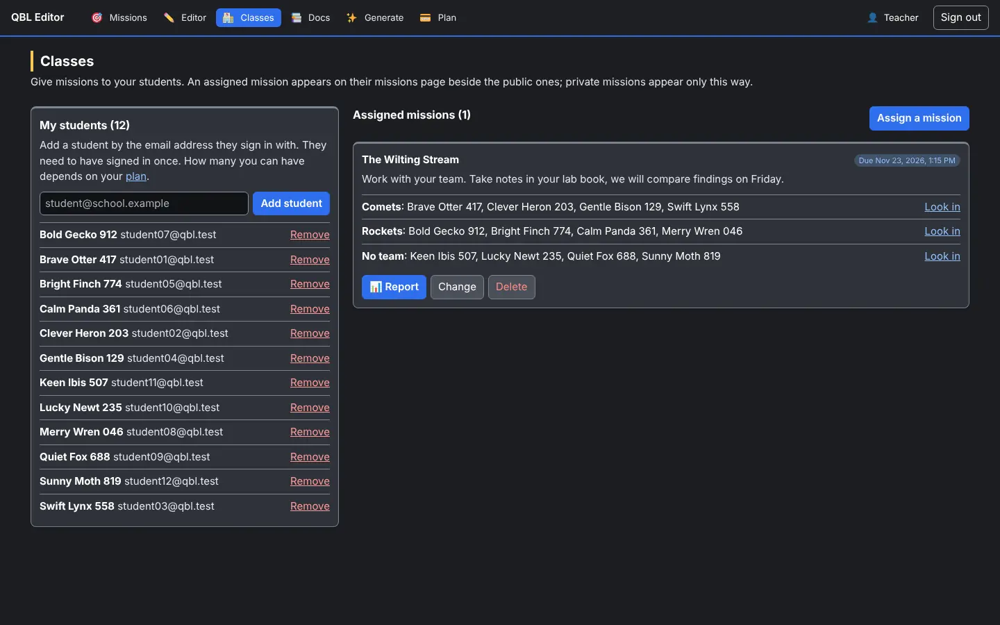
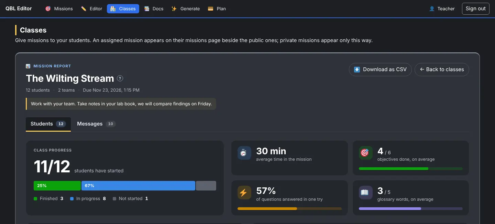
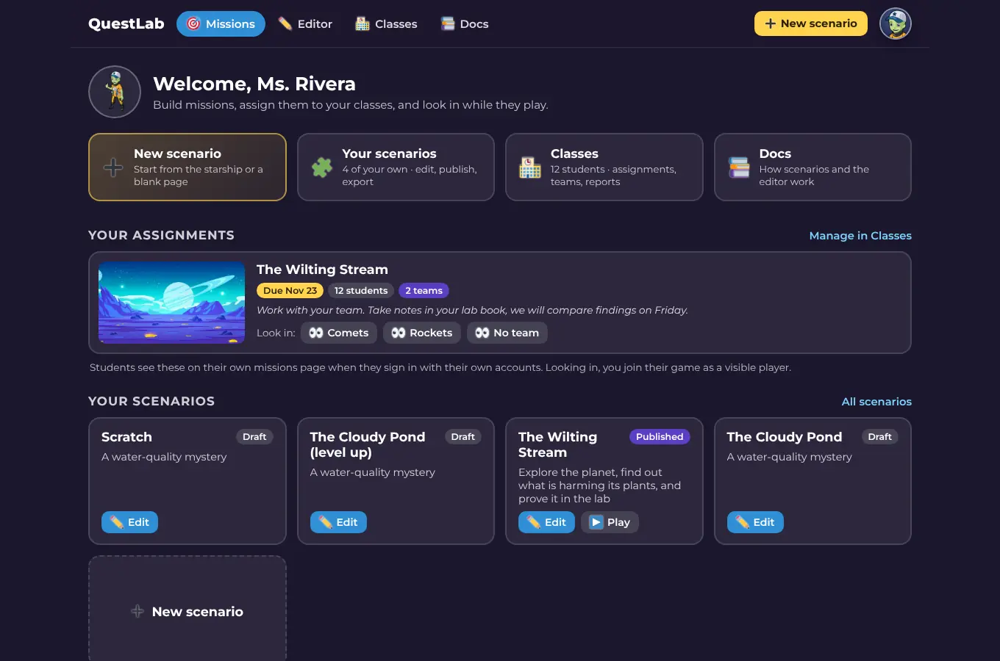
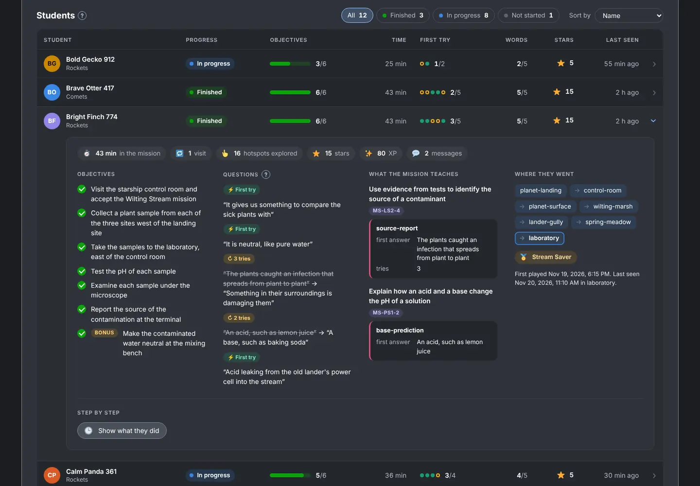

import Host from '../../../components/Host.astro';

import Flow from '../../../components/diagrams/Flow.astro';

import { Aside, Steps, Tabs, TabItem } from '@astrojs/starlight/components';

A mission is not a worksheet you hand out and collect. Think of it as **a field trip with a map**: the world and its puzzles are built, and your job is to be the guide who frames the trip, notices who is lost, asks the right question at the right moment and makes sense of what everyone found.

Students who are left to roam do roam. Students whose teacher has set a purpose, is walking the room and will ask them about it on Friday do something different. Everything below is about being that teacher.

<Aside type="tip" title="The one-line version">
**Brief it, watch it, ask about it, debrief it.** Spend two minutes before, stay present during, ask questions instead of giving answers, and use the evidence afterwards.
</Aside>

<Flow steps={[
  { icon: '📝', title: 'Before', text: 'Play it yourself, assign it, form the teams.' },
  { icon: '📣', title: 'Launch', text: 'Two minutes: the problem, the goal, the roles.' },
  { icon: '🚶', title: 'During', text: 'Circulate. Look in on each team.' },
  { icon: '💬', title: 'After', text: 'Debrief from the report’s first answers.' },
]} caption="Four moments where the teacher makes the mission work." />

## Before: set it up like a lesson

<Steps>

1. **Play it first.** Press **▶ Test** on the mission, or play it as a student would. Fifteen minutes alone is the best preparation there is: you learn where students will get stuck, which question will start the best argument and what the mission teaches that you did not expect. Testing plays alone and saves nothing, so go as often as you like.

2. **Decide what you want students to leave with.** Write the one question you will ask at the end: *"What evidence told you the stream was acidic?"* Everything you do while they play points at it.

3. **Choose the groupings.** Solo, pairs sharing a screen, or [teams](/docs/editor/classes/#teams). Teams each play their own copy of the world, so what one team changes does not affect the next. Mix strengths on purpose: pair a confident reader with a student who thinks aloud.

4. **Write the assignment note.** It appears on every student's mission card, in your voice. Make it a task, not a greeting:

   > *Work with your team. Take notes in your lab book as you go. Be ready to tell the class which sample you think is the problem, and why.*

5. **Set a due date** that fits your plan. A date that has passed is marked on the student's card and in the report.

</Steps>

*Assignments live on the **Classes** page. The note ("Work with your team…") reaches every student's card, and each team has a **Look in** link.*

## At the start: a two-minute launch

Resist the urge to explain the mission. Frame the problem instead and set the rules of the room.

- **The hook:** *"Something is killing the plants beside the stream, and you are the science team that has been called in."*
- **The question:** *"By the end of today you need to be able to say what is causing it and how you know."*
- **The rules:** how to work in a team, what to write in the lab book, what chat is for (and whether it is on).
- **The check:** ask one student to say back what the team is trying to find out.

Then let them go in. The first five minutes should be theirs.

A mission set to **wait for the teacher** stays off the students' missions page until you are ready, so you can do this framing in the hub with everyone together, then launch it from the game's **🚀 Launch a mission** tab: the whole class goes in at once, through a departure scene if the hub has one (the time portal, the shuttle). See [Launch a mission](/docs/editor/classes/#launch-a-mission-when-the-class-is-ready).

## During: circulate and look in

<Host who="val" side="left">
Psst… Team 2 has been at the gate for a while. Walk over before you look in: a question in person beats a hint on screen.
</Host>

Do not sit at your desk. Walk the room, and keep the **Classes → Report** open on your screen as a dashboard.

*The report updates as students play. Eleven of twelve have started and three have finished. On average students have done four of six objectives, and 57% of questions were answered in one try.*

### Read the room in thirty seconds

| You see | It probably means | You could… |
| --- | --- | --- |
| A student has **not started** | Signed in somewhere else, or waiting for a partner | Walk over. Do not assume it is a choice. |
| Many students stuck on the **same objective** | The mission is unclear there, or it needs a skill you have not taught | Pause the class for a ninety-second mini-lesson, then send them back |
| One student far ahead | Rushing, or genuinely ready | Check a first answer or two. If they are right, point them at a bonus objective. If not, slow them down. |
| A team that has been quiet for a while | Disengaged, stuck, or on the wrong thing | **Look in** |

### Look in on a team

**Look in** (on an assignment's card, in **Classes**) puts you into a team's game **as yourself**, and the team sees you. You see what they see, including what the team has changed in their world. Use the **Team you are following** tab (🛡️) at the side of the game to move to another team: you arrive in the scene where most of its players are.

*You can also look in from your missions page: one button per team.*

Looking in is for **conversation, not correction**. Stand next to their avatar and ask a question out loud or in chat. Because you are a visible player, students know you are there, and what you do counts in their game.

### Ask, do not tell

The best facilitation move is a question that sends a student back into the mission with something to find.

| Instead of… | Try… |
| --- | --- |
| "Click the pipe." | "What have you noticed about where the water is muddiest?" |
| "The answer is acidic." | "What would you expect to see if it were acidic? How could you check?" |
| "No, read it again." | "Tell me what the box said in your own words." |
| "You should talk to the captain." | "Who here might know more about this?" |
| "That's wrong." | "What made you choose that one? What would change your mind?" |

### Keep the thinking human

- **Pair on one screen** if you want more talk and fewer clicks: one navigates, one records evidence in the lab book, and they swap at a checkpoint.
- **Ask for a prediction** out loud before a test or an experiment, and write a few on the board. The game records the first answer; you capture the reasoning.
- **Stop the class** when a concept lands, for ninety seconds, and let two students explain it to the room.
- **Use chat on purpose.** Chat can be off, emotes only, or typed and filtered; set it per mission under [Settings](/docs/editor/settings-and-publishing/#settings). If it is on, the **Messages** tab of the report keeps every message so you can follow up on anything off-topic.

## What to do when…

<Tabs>
  <TabItem label="A student rushes">
    A fast student has clicked through every box. Open their detail in the report: how many tries on each question and what was the first answer? If they are right first time, send them to a bonus objective or ask them to *explain it to a teammate*. If not, sit with them: ask them to tell you the story of the mission so far.
  </TabItem>
  <TabItem label="A team is stuck">
    **Look in.** Do not solve it. Ask the team to tell you what they know, what they need and where they have not looked yet. If it is a real design problem (an unclear step), note it: you can fix it in the editor tonight.
  </TabItem>
  <TabItem label="Chat goes off-task">
    Handle it as you would a whispered conversation: a quiet word. Every chat message is logged with sender and time in the report's **Messages** tab. If a mission needs no chat, switch it off in its settings. The change applies as soon as you publish.
  </TabItem>
  <TabItem label="A team finishes early">
    Missions can have **bonus objectives** that do not count towards finishing. Send finishers to them, or give them a role: *go and help another team without giving the answer*. Or ask each finisher to write the question they would add to make the mission harder.
  </TabItem>
  <TabItem label="Someone was absent">
    Progress is saved between visits, so a student can pick up where they stopped. Assign the mission with a due date that allows for it, and check the report for who has not started.
  </TabItem>
</Tabs>

## After: debrief from the evidence

<Host who="sam" side="right">
The best debrief starts with a wrong answer half the class chose. Put it on the board and ask why it was tempting.
</Host>

The best five minutes of the lesson come after the screens are closed. The report gives you what no worksheet can: *what each student thought before any feedback*.

*Open a student to see their objectives, each question's **first answer** and number of tries, evidence for each learning objective, and where they went.*

<Steps>

1. **Find the question the class found hardest.** In the report, look for questions where many students took several tries or chose the same wrong first answer.

2. **Start the debrief with it.** *"Half of you thought the plants were sick because of an infection. What would you expect to see if that were true? What did you see?"*

3. **Let students argue from evidence.** The lab book, the objectives and their first answers are the evidence.

4. **Close with the question you wrote down before the lesson.** Have everyone answer it in one sentence on a card.

5. **Decide what happens next:** re-teach a concept, regroup, assign a follow-up mission on the same standard, or move on.

</Steps>

[Maximizing learning](/docs/educators/maximize-learning/) goes much deeper on using the evidence. For a complete worked plan, see [A class period, step by step](/docs/educators/lesson-plan/).

## A teacher's checklist

- [ ] I have played the mission as a student.
- [ ] I know the one question I want students to answer at the end.
- [ ] My assignment note is a task, not a greeting.
- [ ] Teams are mixed on purpose.
- [ ] I briefed the class in two minutes, and told them what I will ask on Friday.
- [ ] I walked the room and used **Look in** at least once for each team.
- [ ] I opened the report before the debrief and found the hardest question.
- [ ] I wrote down what to fix in the mission itself.
