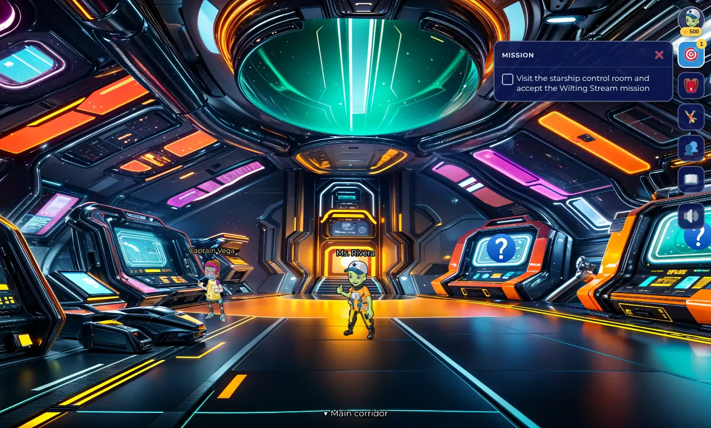
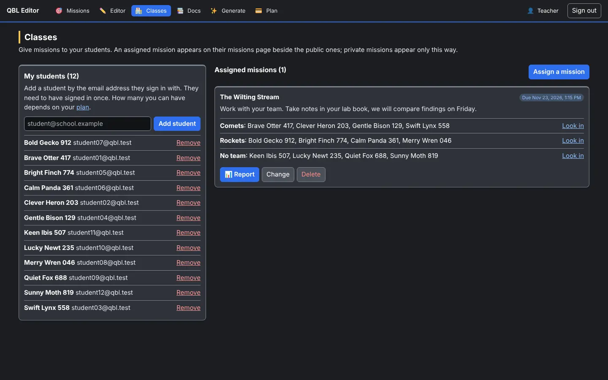

import Host from '../../../components/Host.astro';

import { Card, CardGrid, LinkCard, Aside } from '@astrojs/starlight/components';

> **Students don't watch the lesson. They walk into it. And you walk in with them.**

QuestLab turns a unit into a **mission**: a place students explore as an avatar, with a problem to solve, characters to question, evidence to collect and questions that matter. A class that would have read about water quality is instead standing beside a brown pond, working out where the mud comes from.

*A student arrives in a starship control room. The objective on the right is what they are here to do.*

## What a lesson looks like

1. **You assign a mission** with a due date and a note in your own words: *"Work with your team. Take notes in your lab book. We compare findings on Friday."*
2. **You brief the class** in two minutes and set the question they are chasing.
3. **Students enter the world**, alone or in teams, and the mission gives them something to *do* before it tells them anything.
4. **You circulate.** You can see who is stuck, join a team's game as a visible player, and ask the question that moves them on.
5. **You debrief with their own answers in front of you**: what each student thought *before* they got any feedback, and where the class's misconceptions are.

That last point is what makes QuestLab more than a game. Every question records the **first answer** a student gave and how many tries it took them. A teacher can read a class's thinking in a few minutes, and teach to it the next day.

## Why it works

<CardGrid>
  <Card title="A reason to learn it" icon="rocket">
    Facts arrive when a student needs them: the pH scale makes sense *after* they have seen a test strip turn red beside a dying plant. Missions give the lesson a problem to solve, so the content has somewhere to land.
  </Card>
  <Card title="Doing before being told" icon="pencil">
    Students explore, collect, test and choose. A hotspot that has to be found, an experiment that has to be run: the mission asks for action first and explanation after.
  </Card>
  <Card title="Commit, then learn" icon="approve-check">
    Questions record the first answer *before* the feedback. Students commit to what they think, then find out. Wrong answers get an explanation and another try, not a red cross and a grade.
  </Card>
  <Card title="Teams that depend on each other" icon="star">
    Put students in teams and each team plays its own copy of the world. Generated missions can give each team member a **role** with a job only they can do, and the crew pools what each found.
  </Card>
  <Card title="Evidence you can teach from" icon="seti:graph">
    Not "78%", but *which* question tripped up half the class, what they wrongly chose, and who needs you first. See [the reports](/docs/editor/reports/).
  </Card>
  <Card title="You, in the room" icon="open-book">
    QuestLab is built for a teacher who stays involved. See [You are in the room](/docs/educators/facilitation/) for what that looks like at every step.
  </Card>
</CardGrid>

## You stay at the centre

<Host who="val" side="right">
You choose the mission, you brief the class, you walk the room, and you lead the debrief. The game is the place; you're the teacher.
</Host>

QuestLab is not a way to keep a class busy while you mark. It is designed so that a teacher is involved at **every step**, and so that the teacher's judgement is what turns time in the game into learning.

| Moment | What you do | What QuestLab gives you |
| --- | --- | --- |
| **Before** | Choose the mission, preview it, set the note and the teams | A published library to copy and change, a generator, a full editor and a **Test** button that plays the draft alone, with nothing saved |
| **Launch** | Frame the problem and the rules of the room | An assignment note shown on each student's card, and a due date |
| **During** | Circulate, **look in** on teams, ask rather than tell | Your avatar in a team's game, the live report of who has finished what, and an [audit log of chat](/docs/editor/reports/#the-messages-tab) |
| **Debrief** | Teach to the evidence | First answers, tries and the evidence each learning objective recorded |
| **After** | Follow up, regroup, reassign | Missions you can duplicate and improve, and the same question to ask again |

→ [You are in the room: facilitating a mission](/docs/educators/facilitation/)

*The Classes page. Each team has its own **Look in** link: it puts you in that team's game as a visible player.*

## What you can use on Monday

You do not need to build anything first.

- **Play the sample mission** and assign it. *Starship Explorer* ships with QuestLab: a starship hub with a water-quality mission aboard, in which students collect plant samples, test them in the lab and work out what is poisoning a stream.
- **Copy and adapt.** Missions other teachers have published are listed under *Public missions by others*. **Make my own copy** gives you a draft to rebuild as you like.
- **Generate a first draft.** Describe a mission (the topic, the grade, what students should learn) and the [AI generator](/docs/editor/plans-and-generator/#the-ai-mission-generator) aligns it to standards, writes the story and questions, draws the pictures and hands you a private draft in about ten minutes. It is a first draft from a language model: you check the facts, the reading level and the tone, as you would anyone else's work.
- **Build your own** in the [editor](/docs/editor/). The [walkthrough](/docs/editor/walkthrough/set-up/) takes you from empty to published, with a conversation, a gate and a question, in one sitting.

## Safe by design

<Host who="buck" side="left">
Students play under a made-up name, and chat can be emotes only. I keep an eye on things.
</Host>

- **No personal data about students.** When your school connects QuestLab to its roster, students are known by your school's own opaque id and play under a made-up name such as *Brave Otter 417*. See [Privacy by design](/docs/api-v1/privacy/).
- **Chat you control.** Per mission: off, emotes only, or typed messages (filtered). Every message is kept and you can read them in the report.
- **Nothing is saved when you test.** Play your draft as often as you like.

<Aside type="note">
These pages describe what QuestLab does and how teachers use it. They make no claims about test scores or outcomes: the point is that you can *see* what your students understood, and teach from it.
</Aside>

## Where next

<LinkCard title="You are in the room" description="Facilitating a mission: before, during and after." href="/docs/educators/facilitation/" />
<LinkCard title="A class period, step by step" description="A 50-minute lesson plan you can run tomorrow, plus two-day and three-day arcs." href="/docs/educators/lesson-plan/" />
<LinkCard title="Maximizing learning" description="Seven habits that turn game time into understanding." href="/docs/educators/maximize-learning/" />
<LinkCard title="Mission ideas" description="Twelve missions across science, maths, English, history and more." href="/docs/educators/ideas/" />
