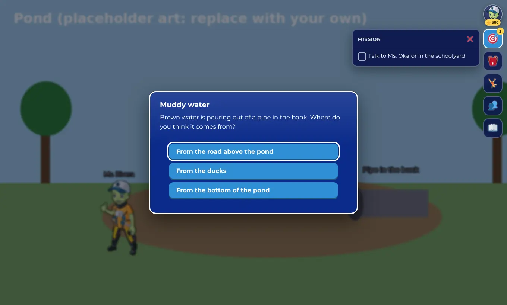
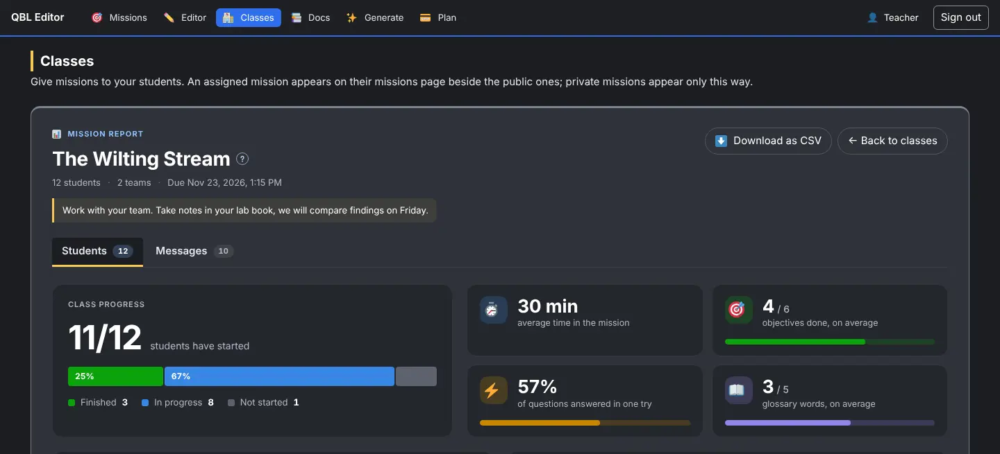

import { Aside, Tabs, TabItem, Steps } from '@astrojs/starlight/components';

Here is a complete lesson you can run tomorrow. It uses the *Starship Explorer* sample mission that comes with QBL, in which students collect plant samples along a stream, test them in the ship's laboratory and work out what is poisoning the plants. The shape works for any mission: **frame, play, pause, play, debrief.**

<Aside type="note">
The learning goals below are the ones this sample mission records: *use evidence from tests to identify the source of a contaminant*, and *explain how an acid and a base change the pH of a solution*. For your own mission, swap in yours.
</Aside>

## The 50-minute plan

| Min | Phase | Teacher | Students |
| --- | --- | --- | --- |
| 0 to 5 | **Frame** | Pose the problem and the question. Set roles and the lab book. | Listen, ask, write a first guess |
| 5 to 25 | **Play, part 1** | Circulate. **Look in** on each team once. | Explore, collect samples, take the first tests |
| 25 to 30 | **Pause** | Stop the class. Mini-lesson on the thing the report shows they are stuck on. | Discuss, adjust their plan |
| 30 to 42 | **Play, part 2** | Circulate. Push finishers to the bonus objective. | Examine samples, report the source |
| 42 to 50 | **Debrief** | Teach to the evidence. Exit ticket. | Argue from evidence. Answer the exit question |

The two things that make it work are the **pause** and the **debrief**. Resist the temptation to let them play for the full period. Forty minutes of uninterrupted play is enjoyable, but it makes a weaker lesson.

### 0 to 5: Frame

Say it out loud, in your own words. For example:

> *"A planet far from here has a stream, and the plants beside it are wilting. You are the science team called in to find out why. By the end of the lesson you must be able to tell me what is causing it, and the evidence that proves it. Write your first guess in your lab book now. You will compare it with your final answer."*

Check understanding by asking one student to say the task back. Tell teams who is navigating first, and when they will swap.

### 5 to 25: Play, part 1

Students enter the mission and meet the captain in the control room. The first objectives are straightforward: accept the mission, collect a plant sample from each of three sites.

**Your job here is to move.** In the first ten minutes, make sure every team has started (open **Classes → Report**: anyone who has not started needs a walk-over). Then **Look in** on each team once and ask one question:

- *"What are you looking for at each site?"*
- *"Why did the captain ask for a healthy plant as well?"* (The mission asks that question itself. Notice whether students answer it before the box does.)

*Questions appear in the world, where students are doing the work. This one is from the Cloudy Pond mission you build in the [walkthrough](/docs/editor/walkthrough/set-up/). Each answer is explained, and a wrong answer invites another try.*

### 25 to 30: Pause

Open the report. You will usually see the class thinning out at one objective, and that is your mini-lesson.

*A pause is the moment to look at the report. If most students are stuck at the same step, teach it for ninety seconds and send them back in.*

For the pH step in this mission, for instance, a ninety-second demonstration works: draw the 0 to 14 scale on the board, mark 7 as pure water, ask *"if a test strip reads 3, what does that tell us?"* and take three answers before you reveal what the mission will tell them. The mission asks the same question later, so you have also given it a rehearsal.

### 30 to 42: Play, part 2

Students examine the samples under the microscope and report the source at the terminal. Faster teams reach the bonus objective, where they try to neutralise the contaminated water. Slower teams may not finish, and that is fine: progress is saved, and the debrief works from where they got to.

Keep circulating. This is the time to ask for **reasons**:

- *"Which test told you the most, and why?"*
- *"Which result surprised you?"*
- *"If it were an infection, what would you expect to see?"*

### 42 to 50: Debrief

Close the screens (or put the tabs aside) and teach from the evidence.

<Steps>

1. **Show a question from the report.** Choose the one where the first answers were split. Without naming anyone, put it on the board with the answers students gave. *"Half of you chose this. What made it attractive?"*

2. **Ask for evidence, not opinions.** *"What did the pH test tell you? What did the microscope add?"* Students refer to the lab book.

3. **Give the one-sentence exit ticket** (below).

4. **Tell them what happens next.** The follow-up mission, the lab write-up, the plan for Monday.

</Steps>

## The lab book

A lab book turns clicks into reasoning, and it is the thing the game cannot do for you. A half-page template is enough:

| My team | |
| --- | --- |
| **My first guess** (before playing): | |
| **Sample 1, 2, 3: what I observed** | |
| **Test results** (pH, microscope) | |
| **What the evidence says** | |
| **My final answer, and why I am sure** | |

## The exit ticket

One sentence each, on a card, handed in at the door:

> *The plants are being harmed by ______. I know this because ______.*

Sorting the cards into three piles (evidence-based, guess, confused) takes two minutes and tells you what Monday's lesson should be.

## Other shapes

<Tabs>
  <TabItem label="Two days">
    **Day 1: Explore.** Frame, play (35 minutes), short debrief: what did you find, what are you unsure of? Students write a plan for tomorrow in their lab book.

    **Day 2: Conclude.** Five-minute recap from the report, play to finish (20 minutes), then a full debrief with the exit ticket. Progress is saved between visits, so students resume where they left off.
  </TabItem>
  <TabItem label="Three days">
    **Day 1: Pre-teach and play.** Teach the vocabulary (the mission's glossary words are a good list), then play for a third of the period.

    **Day 2: Investigate.** Teams play, with you looking in on each one. Midway, stop for a mini-lesson on whatever the report shows is hardest.

    **Day 3: Argue and apply.** Each team presents its conclusion and evidence to the class; the others challenge it. End with a short written task that applies the idea to a new situation, such as testing a pond near the school.
  </TabItem>
  <TabItem label="A 30-minute slot">
    Assign the mission as homework or an earlier session, with a clear note and a due date. In class spend the whole slot on the **debrief**: open the report, find the question that split the class, and teach from it. The mission supplies the experience, and the lesson supplies the sense-making.
  </TabItem>
  <TabItem label="A 90-minute block">
    Run the 50-minute plan, then add a second pass: teams swap roles or lab-book jobs, replay the part they found hardest, and write a joint conclusion. Finish with a gallery walk where teams read one another's conclusions.
  </TabItem>
</Tabs>

## Adapting the plan to your own mission

The structure carries over to any mission:

1. **Write the question you want answered** by the end, and keep it in view.
2. **Find the checkpoint.** Where in the mission will most students need a pause? (Look at the objectives list: it is the natural set of checkpoints.)
3. **Pick the question for the debrief** before you teach: preferably one whose first answers will split the class. Missions made by the [generator](/docs/developers/generation/) include *debrief questions* that the in-game guide asks at the end for exactly this.
4. **Choose the exit ticket** to match the learning goal.

More habits that raise the quality of the lesson are in [Maximizing learning](/docs/educators/maximize-learning/).
