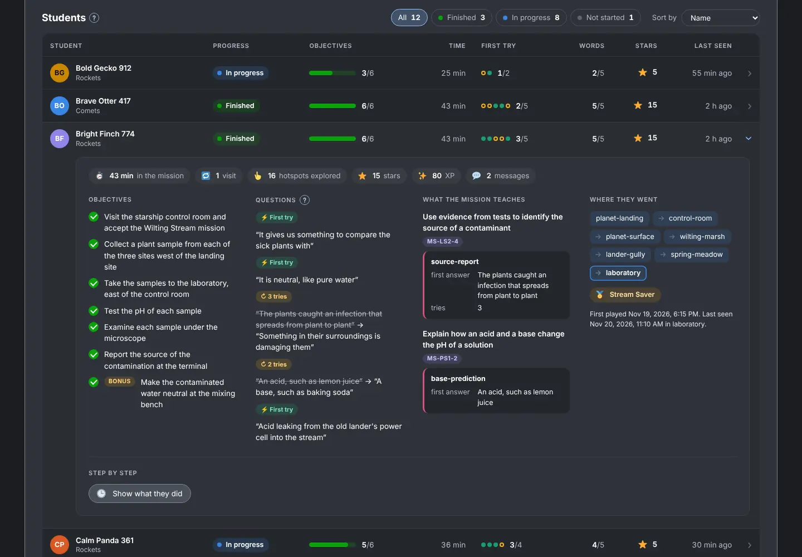

import { Aside, Card, CardGrid } from '@astrojs/starlight/components';

A mission can be a pleasant half hour. It becomes *learning* because of what the teacher does around it. These nine habits come from watching how the tools work, and each one uses a feature QuestLab gives you.

<Aside type="tip" title="If you only do three">
**Brief it** with a question, **read the first answers**, and **debrief from them**. Everything else is a refinement.
</Aside>

## 1. Give the mission a purpose

Students who know *why* they are walking around pay attention to different things. Before they enter:

- Put the **question** in the assignment note, in your words: *"By Friday, tell me what's wrong with the stream and how you know."*
- Say what they will **produce**: a lab-book page, a one-sentence conclusion, a short presentation.
- Tell them what you will **ask afterwards**. Knowing that Friday's discussion starts with their evidence changes how they read.

The note is shown on every student's mission card, and the **due date** is marked when it passes.

## 2. Ask for a prediction first

People learn more from an answer when they have committed to a guess. Before students run a test, open a box, or reach a result, ask them to say what they expect.

- In the room: *"Write what you think the pH strip will read, and why."*
- In the mission: an infobox with an **answer box** records what the student types. Generated missions also include **prediction** questions, which accept every answer and record it before students find out ([details](/docs/developers/generation/#what-a-generated-mission-contains)).

A prediction takes ten seconds and makes the explanation that follows far more memorable. It also reveals what students already believe, which is the raw material of teaching.

## 3. Use the evidence, not just the score

A score says *how much*. The evidence says *what*, and that is what you can teach from.

QuestLab records, for every question a student meets:

- the **first answer** they chose, before any feedback,
- the **number of tries** it took,
- and, in missions that define **learning objectives** (generated missions do), the **evidence** the student produced for each one.

*Open any student in the report. Struck-through answers are the ones they tried first. The coloured cards show the evidence behind each learning objective.*

Two students can both finish with 100% of the objectives. One got the key question right first time; the other took three tries and guessed the third. They need very different things from you on Monday, and only the evidence shows it.

**Five-minute habit:** open the report, pick two students who finished and look at their question-by-question detail. Ask yourself *what does each of them understand that I could check?* Then talk to them.

<Aside type="caution">
The evidence shows what students did in the game. It is **not a grade** and it is not tamper-proof: events run in the browser. Treat it as a very good prompt for a conversation, and weigh it alongside what you see in the room. When you send scores to a gradebook, say plainly how they are made ([how the score is worked out](/docs/api-v1/reports/#how-the-numbers-are-worked-out)).
</Aside>

## 4. Make misconceptions visible, then teach them

A wrong answer chosen by many students is a gift. It tells you precisely what to teach.

- Find a question where first answers were **split** or where many students needed several tries.
- Put it on the board **without names**, along with the answers students gave: *"Half the class thought the plants had caught an infection. What's attractive about that idea?"*
- Ask what evidence would **distinguish** the answers, and send them back to the data.

A good wrong answer is one a reasonable student might choose, which is why the best missions write wrong answers that *teach* when they are picked. See [Designing missions that teach](/docs/educators/design-for-learning/#write-wrong-answers-that-teach).

## 5. Put students in teams on purpose

Teams are more than a grouping. Each team plays **its own copy of the world**, so a team's discoveries and choices belong to the team and what one team does cannot spoil another's.

- **Mix** strengths and confidence. Avoid letting a dominant student drive.
- **Rotate roles** inside the team: navigator, recorder, tester, reporter.
- Missions made by the generator do not split students into roles: everyone can do everything. Assign roles in class if you want them, and have each role report what they found.
- **Look in** on a team to join its conversation. [How](/docs/educators/facilitation/#look-in-on-a-team).

Re-form teams between missions so students work with everyone. You can change teams in an assignment at any time: a team keeps its game and progress when renamed or rearranged.

## 6. Teach vocabulary where it is needed

The glossary gives students a word *when it matters*: a tap on a highlighted word shows what it means and adds it to their glossary, and the report counts how many words each student has collected.

- Use the glossary as your **word list** for the unit.
- Ask students to use two glossary words in their conclusion.
- At the debrief, ask for the *meaning in their own words*, not a recitation.

## 7. Keep a challenge in reserve

Missions can have **bonus objectives**: steps that do not count towards finishing. Use them to keep fast finishers thinking:

- send them to the bonus step,
- ask them to write the next question the mission should ask,
- or ask them to **explain the finding to a team that is still working**, without giving away the answer.

Challenge is better than speed.

## 8. Revisit, and measure improvement honestly

One mission is an event. Learning needs repetition.

- **Return to the idea** in a second mission on the same standard a week or two later, with a different setting.
- **Compare first answers.** Put the same question at the start and the end of a mission (two infoboxes), or ask a similar one in a later mission, and compare what students chose *before any feedback*. That change is the closest thing the report offers to a measure of improvement.
- **Re-ask the exit-ticket question** at the start of the next lesson.

A district can pull this evidence into its own systems with the [public API](/docs/api-v1/reports/#learning-across-missions): per-question first-answer distributions, and completion and scores by curriculum standard.

## 9. Keep the conversation human

The game is a context for thinking, and the thinking happens in talk.

- Use a **lab book** or notebook. The pen is slower than the mouse, which is the point.
- Have students **explain** a step to a partner.
- **Pause** the class and ask two students to explain a concept to the room.
- Ask *"how do you know?"* much more often than *"what is the answer?"*.

## Common pitfalls

| It looks like… | The problem | Try instead |
| --- | --- | --- |
| Students in the world, teacher at the desk | Students roam; nothing connects the clicking to a purpose | Be in the room: [facilitation](/docs/educators/facilitation/) |
| Grading the score | A number hides what students understand | Read the evidence, and grade on conclusions |
| Playing the whole period | No time to make sense of it | Pause midway, and always debrief |
| One mission, one time | Little retention | Revisit the standard in a second mission |
| A flawless run as the goal | Wrong answers are where learning happens | Praise good reasoning from a wrong start |
| Fast finishers wander | Disengagement | Bonus objective, peer explanation, a harder question |

## A weekly rhythm

| Day | Activity |
| --- | --- |
| **Mon** | Introduce the concept; show a short demonstration; set the question |
| **Tue** | Mission, part 1: explore and collect evidence |
| **Wed** | Mini-lesson from the report; mission, part 2 |
| **Thu** | Debrief from first answers; write a conclusion |
| **Fri** | Exit ticket, quick retrieval quiz, and set up next week's follow-up mission |

<CardGrid>
  <Card title="Next: Mission ideas" icon="rocket">
    Twelve missions you can build or generate, across subjects. [See the ideas](/docs/educators/ideas/).
  </Card>
  <Card title="Build your own" icon="pencil">
    Design principles for questions that teach, from the author's side. [Designing missions](/docs/educators/design-for-learning/).
  </Card>
</CardGrid>
