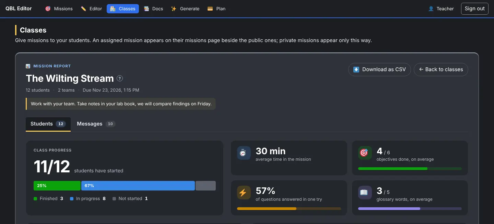

import { Card, CardGrid, LinkCard } from '@astrojs/starlight/components';
import CastLineup from '../../components/CastLineup.astro';

<CastLineup>
  Meet your guides. One of them will be waiting at the top of every page, and they pop up wherever a new topic starts.
</CastLineup>

## Choose your path

<CardGrid>
  <Card title="I teach" icon="open-book">
    Run a mission with your class, stay in the room, and use the evidence afterwards.

    * [Your first class in 20 minutes](/docs/start/quickstart/)
    * [You are in the room: facilitating](/docs/educators/facilitation/)
    * [A class period, step by step](/docs/educators/lesson-plan/)
    * [Maximizing learning](/docs/educators/maximize-learning/)
    * [Mission ideas](/docs/educators/ideas/)
  </Card>
  <Card title="I build missions" icon="pencil">
    Make a mission in the editor, from your own idea or a generated first draft.

    * [The editor at a glance](/docs/editor/)
    * [Walkthrough: The Cloudy Pond](/docs/editor/walkthrough/set-up/)
    * [Infoboxes and questions](/docs/editor/infoboxes/)
    * [Conversations](/docs/editor/conversations/)
    * [Patterns that work](/docs/editor/patterns/)
  </Card>
  <Card title="I run QuestLab for a school" icon="setting">
    Roster classes, sign students in and read grades from your own systems, without sending a name.

    * [The public API (v1)](/docs/api-v1/)
    * [Authentication](/docs/api-v1/authentication/)
    * [Privacy by design](/docs/api-v1/privacy/)
    * [The district admin panel](/docs/editor/district-admin/)
    * [Recipes](/docs/api-v1/recipes/)
  </Card>
  <Card title="I develop QuestLab" icon="seti:json">
    The scenario JSON, runtime extensions, save data, and the architecture, HTTP and multiplayer contracts.

    * [Developer overview](/docs/developers/)
    * [Architecture](/docs/developers/architecture/)
    * [Scenario JSON](/docs/developers/scenario/)
    * [Multiplayer protocol](/docs/developers/protocol/)
  </Card>
</CardGrid>

## What QuestLab is

A **mission** is a place students explore as an avatar: a pond turned brown, a starship laboratory, a market on another planet. They collect evidence, question characters, make predictions and answer questions that give feedback. You assign it with a due date and a note, group students into teams, and **look in** on any team's game as it happens.

The report doesn't just say who finished. It shows each question's **first answer**, before any feedback, so you can teach from what your students actually thought.

<CardGrid>
  <Card title="A teacher in every step" icon="approve-check">
    Brief the class, circulate, look in on teams, debrief from the evidence. [Facilitating a mission](/docs/educators/facilitation/).
  </Card>
  <Card title="Build, copy or generate" icon="rocket">
    A full [editor](/docs/editor/), public missions you can copy, and an [AI generator](/docs/editor/plans-and-generator/#the-ai-mission-generator) that drafts a standards-aligned mission in about ten minutes.
  </Card>
  <Card title="Private by design" icon="seti:lock">
    Schools roster QuestLab without sending names: people are known by your own opaque id and play under a pseudonym. [How](/docs/api-v1/privacy/).
  </Card>
  <Card title="Connects to your systems" icon="seti:graph">
    A versioned [API](/docs/api-v1/) for rostering, assigning, sign-in links, grades, standards coverage and an activity feed.
  </Card>
</CardGrid>
