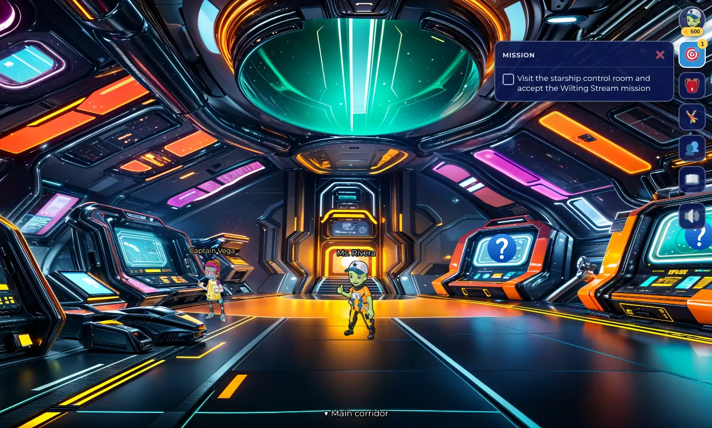
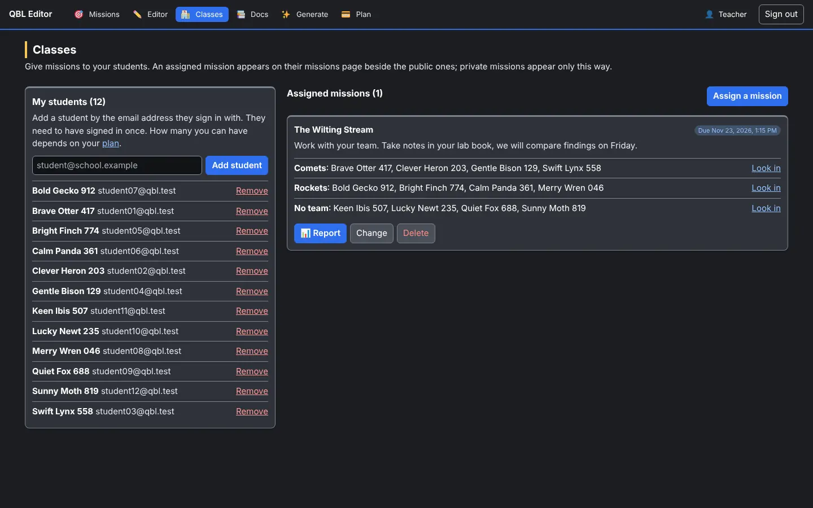
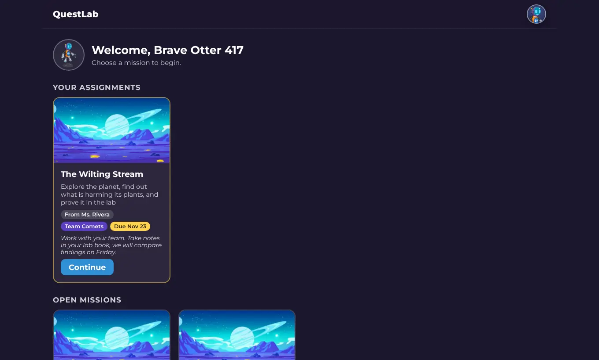
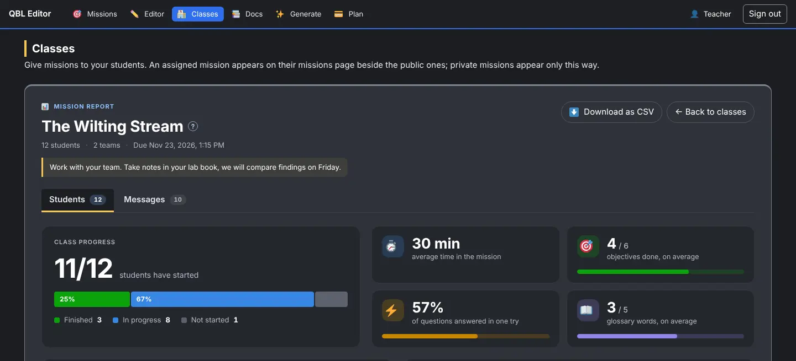

import { Steps, Aside, LinkCard, CardGrid, Card } from '@astrojs/starlight/components';

You can run a real lesson in QuestLab today without building anything. This page takes you from a teacher account to a class playing a mission, and then to a report you can teach from.

**What you need:** a teacher account, and students who can sign in. (No account yet? Choose **Teacher** when you create one, unless your site has turned that off. Otherwise an administrator makes you a teacher, and buying a [teacher plan](/docs/editor/plans-and-generator/) turns a student account into a teacher's.)

<Steps>

1. **Sign in** on the missions page. As a teacher you land on your teaching page there: shortcuts into the editor, your assignments, and missions to try. The bar at the top has the places you use: **Missions**, **Editor**, **Classes**, **Docs**.

2. **Play the sample mission.** Under **Missions to try**, open *Starship Explorer* (it is on the **Editor** page too, with a **Play** button). Walk around with the arrow keys or by clicking. Meet the captain, take the samples, answer the questions. Fifteen minutes now is the best preparation for teaching it.

   

3. **Add your students.** Open **Classes**. Under **My students**, type each student's email and press **Add student**. A student has to have **signed in once** before you can add them.

4. **Assign the mission.** Press **Assign a mission**, pick *Starship Explorer*, choose the students, and add:

   - a **due date**, and
   - a **note** in your own words, such as *"Work with your team. Take notes in your lab book. We compare findings on Friday."*

   Optionally, add **teams**: each team plays its own copy of the world.

   

5. **Brief the class and let them play.** Two minutes: the problem, the question they are chasing, and what you will ask afterwards. Students open **Missions** and find the assignment first, with your note.

   

6. **Look in.** While they play, press **Look in** beside a team. You join their game as a visible player. Ask a question; do not give an answer. Use the **Team you are following** tab (🛡️) in the game to move to another team.

7. **Read the report.** Press **Report** on the assignment. See who has started, who has finished, where the class is stuck and, for each student, what they answered *first*.

   

8. **Debrief from the evidence.** Pick the question where first answers were split and begin there.

</Steps>

<Aside type="tip">
For a ready-made lesson built around this exact sequence, see [A class period, step by step](/docs/educators/lesson-plan/).
</Aside>

## Make it your own

When you have run one mission, choose how to get your next one:

<CardGrid>
  <Card title="Copy and adapt" icon="pencil">
    On the **Editor** page, press **Duplicate** on any mission (or **Make my own copy** under *Public missions by others*). Change the text, add a scene, rewrite a question. The original is untouched.
  </Card>
  <Card title="Generate a draft" icon="star">
    Describe a mission and the [generator](/docs/editor/plans-and-generator/#the-ai-mission-generator) writes, draws and builds a draft in about ten minutes. You review and edit it. Needs a plan that includes it.
  </Card>
  <Card title="Build from scratch" icon="rocket">
    The [walkthrough](/docs/editor/walkthrough/set-up/) builds a two-scene mission from an empty scenario in about an hour, using every kind of piece.
  </Card>
  <Card title="Browse ideas" icon="open-book">
    [Twelve mission ideas](/docs/educators/ideas/) across science, maths, English, history, languages and school life.
  </Card>
</CardGrid>

## Troubleshooting the first run

| Problem | Try |
| --- | --- |
| You cannot add a student | They have probably not signed in yet. Ask them to sign in once on the missions page, then add them again |
| A student cannot see the assignment | Check you added the right email, and that they are signed in with that account. To check their view, use another browser or a private window: the game and the editor share one sign-in per browser |
| The mission shows a 🔒 | It is a curricular mission and your plan does not include it; see [Plans](/docs/editor/plans-and-generator/#free-and-curricular-missions) |
| You want to try changes without affecting students | Press **▶ Test** in the editor: it plays your unpublished draft alone and saves nothing |

<LinkCard title="Next: How QuestLab works" description="Scenarios, scenes, events, actions, conditions and variables in five minutes." href="/docs/start/concepts/" />
